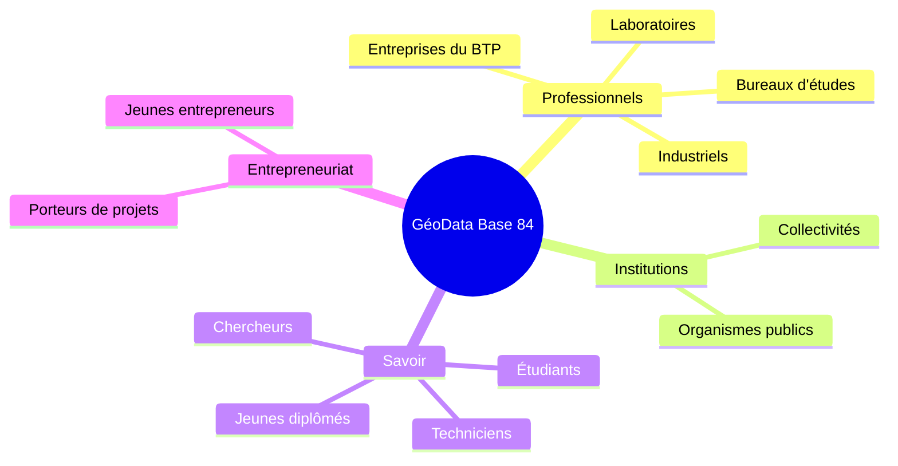
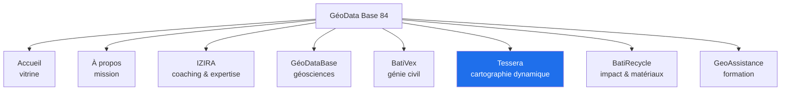

# 1. Vision, publics et périmètre

[← Sommaire](README.md)

## Vision

GéoData Base 84 est une plateforme algérienne de géosciences, de technologies géospatiales et d'accompagnement. Le site doit faire trois choses :

1. **Présenter** une offre large (géologie, géotechnique, SIG, BTP, recyclage, formation, coaching) sans perdre le visiteur.
2. **Convertir** chaque prestation en demande exploitable : où est le site, quel service, quel livrable, quelle modalité.
3. **Montrer le savoir-faire** grâce à un outil cartographique 3D (Tessera) qui sert à la fois de vitrine et de point d'entrée des demandes.

## Objectifs mesurables

| Objectif | Indicateur | Cible suggérée (à valider) |
| --- | --- | --- |
| Générer des demandes qualifiées | Demandes d'étude reçues / mois | 20+ |
| Remplir l'agenda | RDV réservés / mois | 10+ |
| Faire vivre Tessera | Signalements de risque modérés / mois | 5+ |
| Être trouvé | Pages de services indexées | 100 % |
| Monétiser la visibilité | Partenaires abonnés | 3 la première année |

## Publics cibles

| Public | Ce qu'il cherche | Volets |
| --- | --- | --- |
| Entreprises BTP, BET | Études de sol, interprétation d'essais, matériaux | BatiVex, BatiRecycle, Tessera |
| Industriels, laboratoires | Formulation, valorisation, visibilité | BatiRecycle, Partenaires |
| Institutions | Cartes d'aléas, microzonage, bases SIG | Tessera, GéoDataBase |
| Chercheurs | Données, modélisation, cartographie | GéoDataBase, Tessera |
| Étudiants, techniciens | Formations, tutoriels, mini-projets | GeoAssistance |
| Porteurs de projets | Coaching, business plan, stratégie | IZIRA |

## Les 8 volets

Tessera est le seul volet **dynamique** (carte, données, signalements). Les autres sont des **catalogues** qui renvoient vers les mêmes modules de demande et de rendez-vous.

## Périmètre

### Inclus
- Refonte complète des pages Accueil et Tessera (anciennes versions remplacées).
- Création de BatiRecycle, BatiVex (avec RDV), IZIRA.
- Formulaires de demande d'étude, réservation de RDV, signalement de risque.
- Carte Google 3D avec couches d'aléas.
- Back-office complet, rôles, notifications.
- Annuaire et abonnements partenaires, seconde langue, SEO.

### Exclu (sauf avenant)
- Rédaction et traduction des contenus, photos.
- Production des couches cartographiques (fournies par la cliente).
- Coûts Google Cloud, Google Maps Platform, Neon, emails, domaine.
- Espace apprenant avec compte (e-learning) et paiement en ligne — voir [points ouverts](10-points-ouverts.md).
