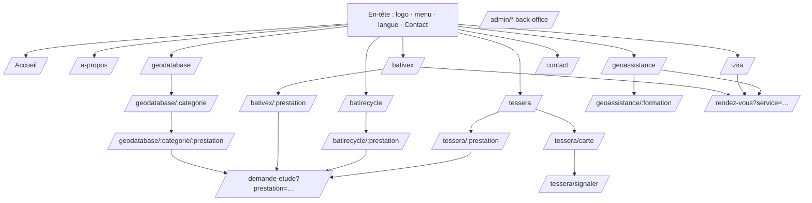
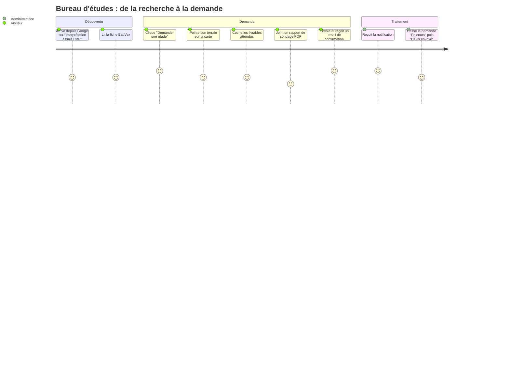
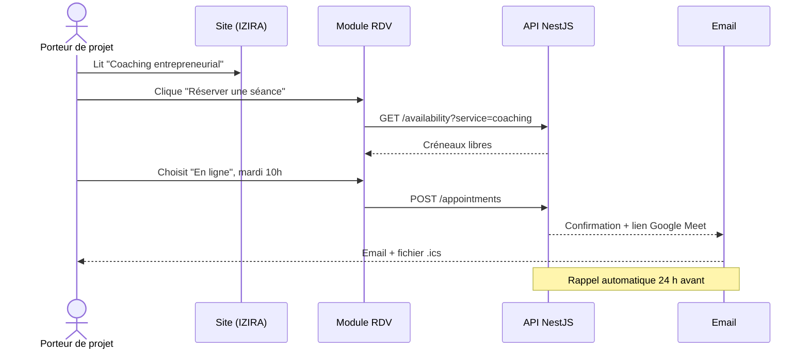
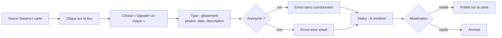
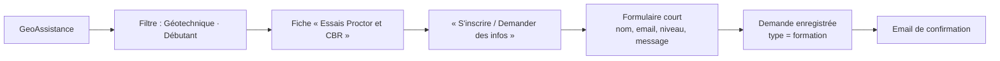

# 2. Arborescence et parcours utilisateurs

[← Sommaire](README.md)

## Plan du site



## Routes front-end (TanStack Router)

Toutes les routes publiques sont préfixées par la langue : `/fr/...`, `/en/...` (ou `/ar/...`).

| Route | Écran | Rendu |
| --- | --- | --- |
| `/$lang` | Accueil | Pré-rendu (SSG) |
| `/$lang/a-propos` | À propos | SSG |
| `/$lang/izira` | IZIRA | SSG |
| `/$lang/geodatabase` | Catalogue GéoDataBase | SSG |
| `/$lang/geodatabase/$categorie/$prestation` | Fiche prestation | SSG |
| `/$lang/bativex` · `/$lang/bativex/$prestation` | BatiVex | SSG |
| `/$lang/tessera` | Présentation Tessera | SSG |
| `/$lang/tessera/carte` | Carte 3D | Client (SPA) |
| `/$lang/tessera/signaler` | Signalement | Client |
| `/$lang/batirecycle` · `/$prestation` | BatiRecycle | SSG |
| `/$lang/geoassistance` · `/$formation` | Catalogue de formations | SSG |
| `/$lang/demande-etude` | Formulaire de demande | Client |
| `/$lang/rendez-vous` | Réservation | Client |
| `/$lang/contact` | Contact | SSG + formulaire client |
| `/admin/*` | Back-office | Client, protégé |

## Navigation

```
┌──────────────────────────────────────────────────────────────────────────────┐
│ [LOGO]  Accueil  À propos  Moi  GéoDataBase  BatiVex  Tessera  BatiRecycle   │
│         GeoAssistance                         [FR ▾]  [Contact]  [Demander]  │
└──────────────────────────────────────────────────────────────────────────────┘
```

Sur mobile : logo + bouton menu (tiroir latéral). Le sélecteur de langue et le bouton **« Demander une étude »** restent visibles en permanence.

## Parcours 1 — Un BET demande une étude de sol



## Parcours 2 — Un porteur de projet réserve un coaching



## Parcours 3 — Un citoyen signale un glissement de terrain



## Parcours 4 — Un étudiant s'inscrit à une formation


