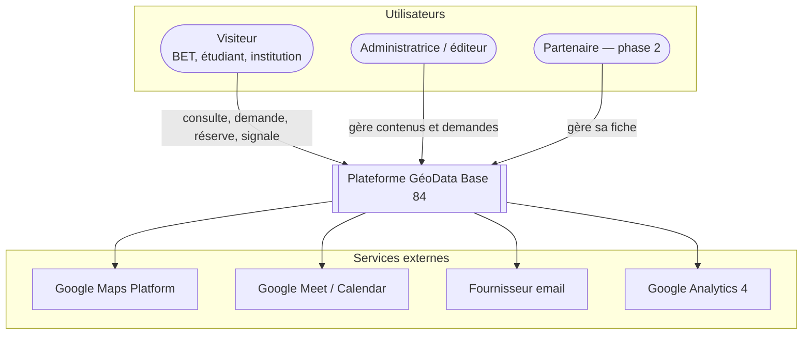
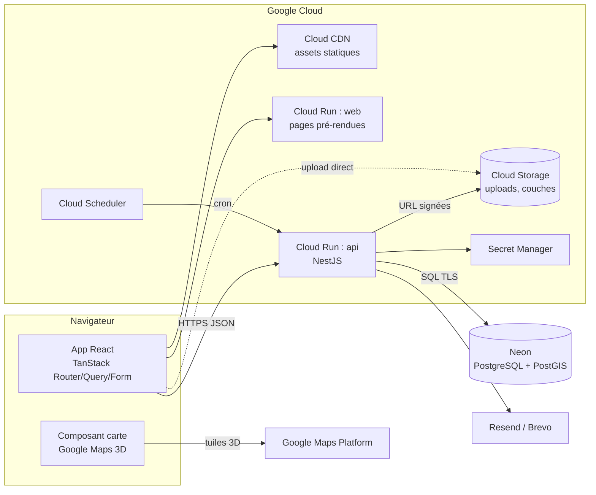
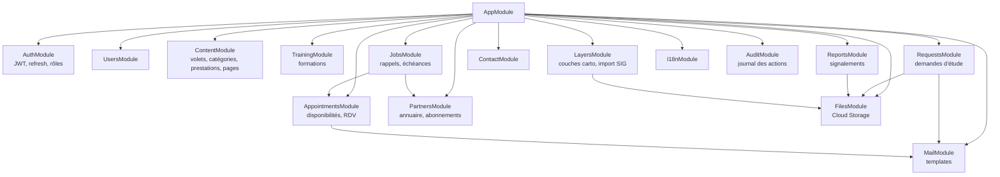
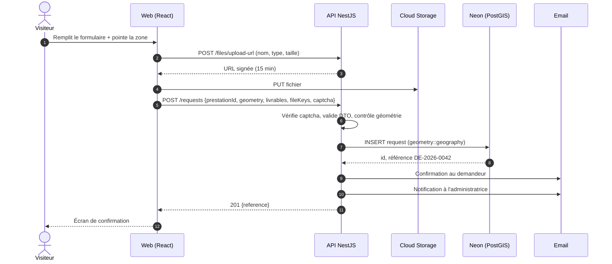

# 3. Architecture technique

[← Sommaire](README.md)

## Choix techniques

| Couche | Technologie | Rôle |
| --- | --- | --- |
| Front-end | React 19, Vite, TypeScript | Interface publique et back-office |
| Routage | TanStack Router (ou TanStack Start pour le pré-rendu) | Routes typées, chargement de données par route |
| Données côté client | TanStack Query | Cache, synchronisation avec l'API |
| Formulaires | TanStack Form + Zod | Validation partagée avec l'API |
| Tableaux back-office | TanStack Table | Tri, filtres, pagination |
| Style | Tailwind CSS + composants maison | Design system ([§6](06-design-system.md)) |
| Cartographie | Google Maps JS API, Photorealistic 3D Tiles, Drawing / Geometry | Carte Tessera |
| API | NestJS 11 (REST), class-validator, Swagger | Logique métier |
| ORM | Prisma (ou Drizzle) + extension PostGIS | Accès base, migrations |
| Base de données | Neon (PostgreSQL 16 + PostGIS 3) | Données et géométries |
| Fichiers | Google Cloud Storage (URL signées) | Pièces jointes, photos, couches |
| Emails | Resend ou Brevo | Transactionnels |
| Tâches planifiées | Cloud Scheduler → endpoint NestJS | Rappels RDV, échéances partenaires |
| Hébergement | Cloud Run (front + API), Cloud CDN | Mise à l'échelle automatique |
| Secrets | Secret Manager | Clés API, URL de base |

## Vue de contexte (C4 niveau 1)



## Vue des conteneurs (C4 niveau 2)



## Découpage du back-end (modules NestJS)



Chaque module suit le même découpage : `controller` (routes) → `service` (règles métier) → `repository` (accès base) + `dto` (validation).

## Structure du dépôt (monorepo)

```
geodata-base-84/
├── apps/
│   ├── web/                     # React + TanStack
│   │   ├── src/
│   │   │   ├── routes/          # fichiers de routes TanStack
│   │   │   │   ├── $lang/
│   │   │   │   │   ├── index.tsx
│   │   │   │   │   ├── tessera/carte.tsx
│   │   │   │   │   └── ...
│   │   │   │   └── admin/
│   │   │   ├── features/        # demande-etude, rdv, carte, signalement...
│   │   │   ├── components/ui/   # design system
│   │   │   ├── lib/api.ts       # client HTTP typé
│   │   │   └── i18n/
│   │   └── vite.config.ts
│   └── api/                     # NestJS
│       ├── src/modules/
│       ├── prisma/schema.prisma
│       └── test/
├── packages/
│   ├── shared/                  # schémas Zod, types, constantes (aléas, statuts)
│   └── config/                  # eslint, tsconfig
├── infra/                       # Terraform ou scripts gcloud
└── .github/workflows/           # CI/CD
```

Le paquet `shared` évite de dupliquer les règles : la liste des aléas, les statuts de demande et les schémas de formulaire sont écrits une fois et utilisés par le front et l'API.

## Flux type : soumission d'une demande d'étude



## Rendu et SEO

React + TanStack charge les pages dans le navigateur, ce que les moteurs indexent moins bien. Deux options, dans l'ordre de préférence :

1. **TanStack Start** en mode pré-rendu : toutes les pages de contenu (volets, prestations, formations) sont générées en HTML au build, puis l'app prend le relais.
2. **Vite + plugin de prerender** sur la liste des routes publiques, si l'on reste en SPA pure.

La carte, les formulaires et le back-office restent rendus côté client.

## Décisions d'architecture

| # | Décision | Raison | Alternative écartée |
| --- | --- | --- | --- |
| ADR-01 | API REST plutôt que GraphQL | Besoins simples, cache CDN facile, Swagger | GraphQL |
| ADR-02 | PostGIS dans Neon | Requêtes spatiales (intersection zone/aléa), un seul stockage | Base séparée type Firestore |
| ADR-03 | Upload direct navigateur → GCS | Ne surcharge pas Cloud Run, gros fichiers SHP | Upload via l'API |
| ADR-04 | Back-office dans la même app React | Un seul déploiement, mêmes composants | CMS headless externe |
| ADR-05 | Couches stockées en GeoJSON simplifié + original | Affichage rapide, original conservé pour export | Tuiles vectorielles (surdimensionné au départ) |
| ADR-06 | Monorepo avec paquet partagé | Schémas de validation communs | Deux dépôts |
