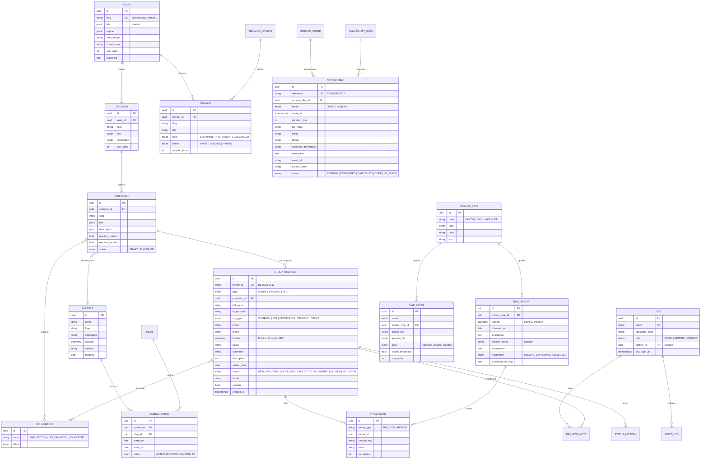
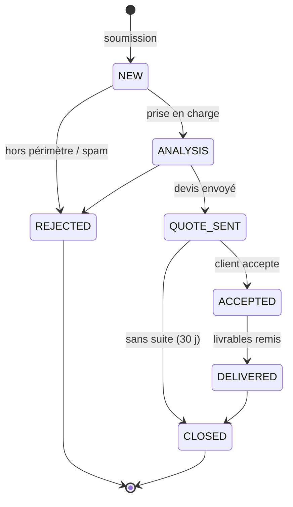
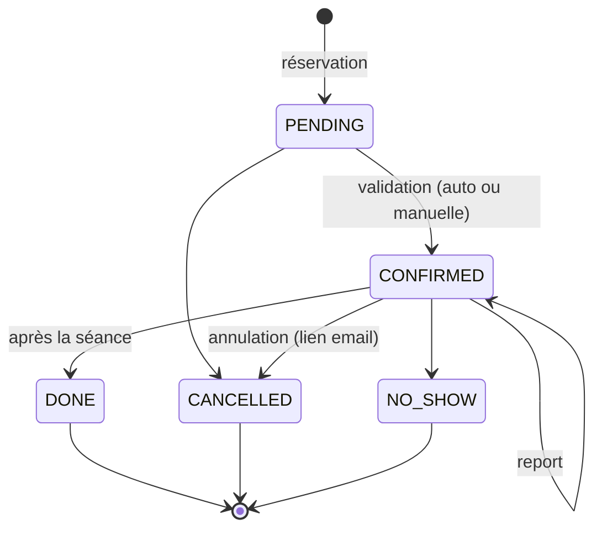

# 4. Modèle de données

[← Sommaire](README.md)

Base : **Neon (PostgreSQL 16 + PostGIS)**. Les géométries sont stockées en `geometry(…, 4326)` (WGS 84, le système de Google Maps).

## Diagramme entité-relation



Tables secondaires non détaillées dans le schéma : `TRAINING_DOMAIN`, `SERVICE_OFFER` (services réservables : coaching, BatiVex, formation), `AVAILABILITY_RULE` (plages horaires récurrentes + exceptions), `PLAN` (paliers d'abonnement), `REQUEST_NOTE`, `STATUS_HISTORY`, `CONTACT_MESSAGE`, `AUDIT_LOG`, `PAGE_CONTENT` (blocs de texte libres des pages Accueil, À propos, IZIRA).

## Cycle de vie d'une demande d'étude



Chaque changement de statut crée une ligne dans `STATUS_HISTORY` (qui, quand, commentaire) et peut déclencher un email au demandeur.

## Cycle de vie d'un rendez-vous



## Requêtes spatiales utiles

```sql
-- Aléas qui touchent la zone d'une demande
SELECT h.code, l.name
FROM study_request r
JOIN map_layer_feature f ON ST_Intersects(f.geom, r.location)
JOIN map_layer l ON l.id = f.layer_id
JOIN hazard_type h ON h.id = l.hazard_type_id
WHERE r.id = $1;

-- Signalements publiés dans la vue de la carte
SELECT id, hazard_type_id, ST_AsGeoJSON(location) AS geojson
FROM risk_report
WHERE published_on_map
  AND location && ST_MakeEnvelope($west, $south, $east, $north, 4326);

-- Surface d'une zone dessinée, en hectares
SELECT ST_Area(location::geography) / 10000 AS hectares FROM study_request WHERE id = $1;
```

## Index

| Table | Index | Raison |
| --- | --- | --- |
| `study_request` | GIST(`location`), BTREE(`status`, `created_at`) | Carte des demandes, liste back-office |
| `risk_report` | GIST(`location`), BTREE(`moderation`) | Affichage par emprise, file de modération |
| `map_layer_feature` | GIST(`geom`) | Intersections |
| `appointment` | UNIQUE(`starts_at`, `service_offer_id`) WHERE status IN (PENDING, CONFIRMED) | Empêche la double réservation |
| `prestation` | UNIQUE(`category_id`, `slug`) | URL lisibles |

## Textes multilingues

Les champs traduisibles sont en `jsonb` : `{"fr": "Cartographie géologique", "en": "Geological mapping"}`. L'API renvoie la langue demandée (en-tête `Accept-Language` ou paramètre `?lang=`) et retombe sur le français si la traduction manque.
