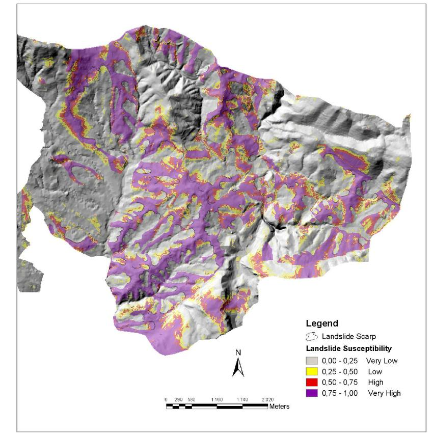
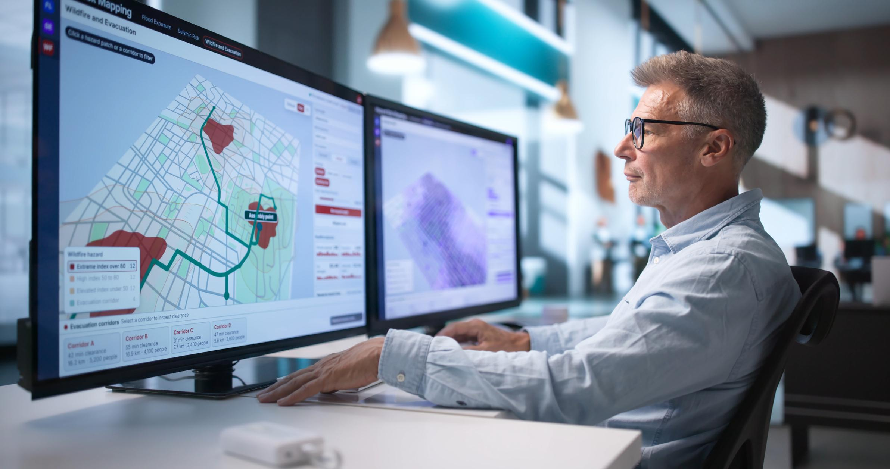
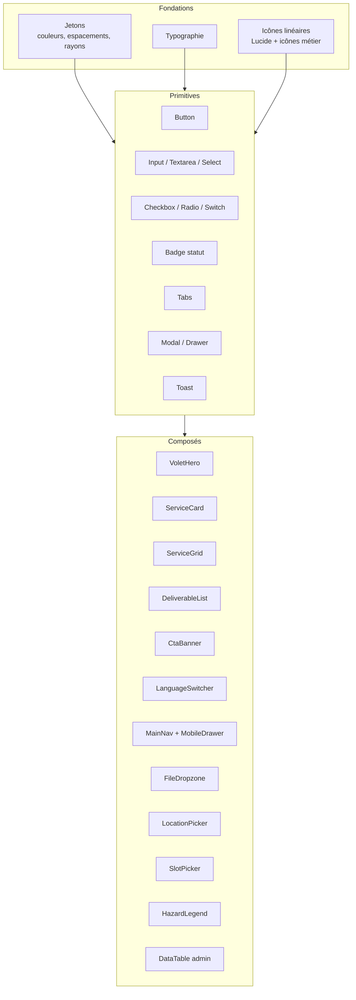

# 6. Design system et direction artistique

[← Sommaire](README.md)

## Intention

Une **plateforme géospatiale technologique** : accueil sombre façon tableau de bord de gestion des risques, imagerie satellite et cartes thématiques dans les volets, sections claires pour lire les catalogues.


*Maquette fournie : menu horizontal rouge (indication de position, couleur à valider), logo en haut à gauche, sélecteur de langue en bas à gauche, Contacts en bas à droite, visuel « Disaster Risk Management Platform » en fond.*

## Références visuelles et usage

| Référence | Usage |
| --- | --- |
|  | Bandeau GéoDataBase, fonds de sections |
|  | Style des légendes Tessera (classes de susceptibilité) |
|  | Bandeau Tessera |
|  | Bandeau GeoAssistance |
|  | Catégorie Paléontologie |
|  | Bandeau BatiRecycle |

La vidéo `inspo.mp4` reste à analyser avec la cliente (ambiance, animations).

## Jetons de couleur

```css
:root {
  /* Fond et texte */
  --bg-night:      #0B1426;  /* accueil, Tessera */
  --bg-night-2:    #12203A;  /* cartes sur fond sombre */
  --bg-light:      #F6F7F9;  /* catalogues */
  --surface:       #FFFFFF;
  --text:          #14171F;
  --text-muted:    #5B6475;
  --text-on-dark:  #E8EDF6;
  --border:        #DDE2EA;

  /* Marque */
  --primary:       #1F6FEB;  /* liens, boutons principaux */
  --primary-hover: #1858BC;

  /* Accent par volet */
  --volet-geodatabase:   #8B5CF6;
  --volet-bativex:       #F59E0B;
  --volet-tessera:       #06B6D4;
  --volet-batirecycle:   #22C55E;
  --volet-geoassistance: #3B82F6;
  --volet-izira:         #EC4899;

  /* Échelle d'aléas (carte + légendes) */
  --hazard-very-low:  #9CA3AF;
  --hazard-low:       #FACC15;
  --hazard-medium:    #F97316;
  --hazard-high:      #DC2626;
  --hazard-very-high: #7E22CE;
}
```

Les couleurs de marque sont provisoires tant que la cliente n'a pas fourni son logo vectoriel et ses couleurs officielles.

## Typographie

| Usage | Police | Taille / graisse |
| --- | --- | --- |
| Titres | Space Grotesk (ou équivalent technique) | 40/32/24/20 px, 600 |
| Texte | Inter | 16 px, 400, interligne 1,6 |
| Données, coordonnées | JetBrains Mono | 13 px |
| Arabe (si retenu) | IBM Plex Sans Arabic | mêmes tailles |

## Gabarit commun des volets

```
┌───────────────────────────────────────────────────────────────┐
│ EN-TÊTE                                                       │
├───────────────────────────────────────────────────────────────┤
│ BANDEAU  [visuel plein cadre]                                 │
│   Titre du volet                                              │
│   Accroche                                [Demander une étude]│
├───────────────────────────────────────────────────────────────┤
│ PRÉSENTATION  (2–3 paragraphes)                               │
├───────────────────────────────────────────────────────────────┤
│ CATALOGUE  — onglets ou ancres par catégorie                  │
│ ┌─────────┐ ┌─────────┐ ┌─────────┐ ┌─────────┐               │
│ │ icône   │ │ icône   │ │ icône   │ │ icône   │               │
│ │ titre   │ │ titre   │ │ titre   │ │ titre   │               │
│ │ 2 lignes│ │ 2 lignes│ │ 2 lignes│ │ 2 lignes│               │
│ │ [Voir →]│ │ [Voir →]│ │ [Voir →]│ │ [Voir →]│               │
│ └─────────┘ └─────────┘ └─────────┘ └─────────┘               │
├───────────────────────────────────────────────────────────────┤
│ LIVRABLES POSSIBLES  (puces avec icônes)                      │
├───────────────────────────────────────────────────────────────┤
│ PARTENAIRES ASSOCIÉS (si prestation en partenariat)           │
├───────────────────────────────────────────────────────────────┤
│ APPEL À L'ACTION  [Demander une étude] [Prendre RDV]          │
├───────────────────────────────────────────────────────────────┤
│ PIED DE PAGE                                                  │
└───────────────────────────────────────────────────────────────┘
```

## Bibliothèque de composants



## Points de rupture

| Nom | Largeur | Grille |
| --- | --- | --- |
| mobile | < 640 px | 1 colonne, marges 16 px |
| tablette | 640–1023 px | 2 colonnes |
| bureau | 1024–1439 px | 3–4 colonnes, conteneur 1200 px |
| large | ≥ 1440 px | 4 colonnes, conteneur 1320 px |

## Animations

- Apparition douce au défilement (opacité + 16 px), 300 ms.
- Survol des cartes de volet : élévation légère et liseré de la couleur du volet.
- Hero d'accueil : parallaxe lente sur le fond, désactivée si `prefers-reduced-motion`.
- Aucune animation ne bloque la lecture ni la saisie.

## Accessibilité

- Contraste minimal 4,5:1 pour le texte (vérifié sur fond sombre).
- Navigation complète au clavier, focus visible.
- Textes alternatifs sur toutes les images, légendes textuelles des cartes.
- Les couleurs d'aléas sont toujours doublées d'un libellé (jamais la couleur seule).
