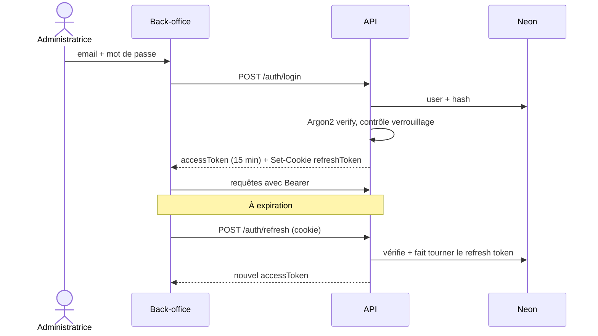

# 7. Sécurité, performance et conformité

[← Sommaire](README.md)

## Menaces et parades

| Menace | Parade |
| --- | --- |
| Spam sur les formulaires | Captcha invisible (Turnstile / reCAPTCHA v3), limite de débit par IP, champ piège caché |
| Injection SQL | Requêtes paramétrées via l'ORM, aucune concaténation |
| XSS | Échappement React par défaut, assainissement du texte riche (DOMPurify), en-tête CSP |
| Fichiers malveillants | Liste blanche d'extensions et de types MIME, taille max, noms aléatoires, bucket privé, URL signées à durée courte |
| Vol de session | Access token court (15 min), refresh token en cookie HttpOnly + Secure + SameSite=Strict, rotation |
| Force brute sur la connexion | Verrouillage après 5 échecs / 15 min, mots de passe hachés en Argon2id |
| Élévation de droits | Gardes NestJS par rôle sur chaque route admin, tests automatisés des accès |
| Fuite de clé Google Maps | Clé restreinte par référent HTTP et par API, quota journalier |
| Exposition de données personnelles | Les signalements publiés n'affichent jamais l'email du signaleur |

## Flux d'authentification



## En-têtes HTTP

```
Strict-Transport-Security: max-age=31536000; includeSubDomains
Content-Security-Policy: default-src 'self'; script-src 'self' https://maps.googleapis.com https://challenges.cloudflare.com; img-src 'self' data: https://*.googleapis.com https://*.gstatic.com https://storage.googleapis.com; connect-src 'self' https://api.geodatabase84.dz https://*.googleapis.com; frame-src https://challenges.cloudflare.com
X-Content-Type-Options: nosniff
Referrer-Policy: strict-origin-when-cross-origin
Permissions-Policy: geolocation=(self), camera=(), microphone=()
```

## Performance

| Mesure | Cible |
| --- | --- |
| LCP des pages de contenu (4G) | < 2,5 s |
| Poids JS initial d'une page de contenu | < 180 Ko compressé |
| Chargement de la carte | À la demande, uniquement sur `/tessera/carte` |
| Images | AVIF/WebP, `srcset`, chargement différé sous la ligne de flottaison |
| Couches GeoJSON | Géométries simplifiées à l'import, cache CDN 1 h, invalidation à la mise à jour |
| API | p95 < 300 ms hors upload |

Découpage du code par route (TanStack Router le fait nativement) : la bibliothèque Google Maps n'est jamais chargée sur les pages qui ne l'utilisent pas.

## Données personnelles

Cadre : **loi algérienne n° 18-07** relative à la protection des personnes physiques dans le traitement des données à caractère personnel.

| Exigence | Mise en œuvre |
| --- | --- |
| Consentement | Case obligatoire non pré-cochée sur chaque formulaire, texte de finalité |
| Information | Page « Politique de confidentialité » et « Mentions légales » |
| Minimisation | Seuls les champs nécessaires sont obligatoires ; signalement anonyme possible |
| Durée de conservation | Demandes : 3 ans après clôture ; messages de contact : 1 an ; signalements anonymes : indéfini sans donnée personnelle |
| Droits d'accès et suppression | Demande par email ; suppression ou anonymisation depuis le back-office |
| Hébergement hors d'Algérie | Google Cloud et Neon sont hors du territoire : à mentionner dans la politique de confidentialité et à vérifier avec la cliente (déclaration éventuelle auprès de l'ANPDP) |

## Sauvegardes et reprise

- Neon : historique point-in-time (7 jours selon l'offre) + export logique quotidien vers Cloud Storage, conservé 30 jours.
- Cloud Storage : versionnement d'objets activé sur le bucket des uploads.
- Objectif de reprise : < 4 h ; perte de données maximale : < 24 h.

## Journalisation et suivi

- Logs structurés JSON (Cloud Logging), sans données personnelles en clair.
- Journal d'audit en base pour chaque action d'administration (qui, quoi, quand, avant/après).
- Alertes Cloud Monitoring : taux d'erreur 5xx > 2 %, latence p95 > 1 s, quota Google Maps à 80 %.
