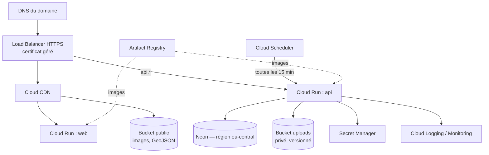
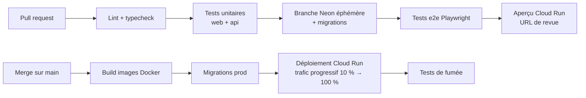

# 8. Déploiement et environnements

[← Sommaire](README.md)

## Environnements

| Environnement | Front | API | Base Neon | Usage |
| --- | --- | --- | --- | --- |
| Local | Vite dev server | `nest start --watch` | Branche Neon `dev-<prénom>` | Développement |
| Recette | `staging.geodatabase84.dz` | `api-staging…` | Branche `staging` | Validation par la cliente |
| Production | `geodatabase84.dz` | `api.geodatabase84.dz` | Branche `main` | Public |

Neon permet de créer une **branche de base par pull request** : chaque fonctionnalité est testée sur une copie des données sans toucher à la production.

## Infrastructure Google Cloud



Région GCP conseillée : `europe-west1` (Belgique) ou `europe-west9` (Paris), au plus près de la région Neon et des utilisateurs algériens.

## Chaîne CI/CD (GitHub Actions)



## Variables d'environnement

```bash
# API
DATABASE_URL=postgresql://…@ep-xxx.eu-central-1.aws.neon.tech/geodata?sslmode=require
JWT_ACCESS_SECRET=…
JWT_REFRESH_SECRET=…
GCS_BUCKET_UPLOADS=gdb84-uploads
GCS_BUCKET_PUBLIC=gdb84-public
MAIL_PROVIDER_API_KEY=…
MAIL_FROM="GéoData Base 84 <contact@geodatabase84.dz>"
ADMIN_NOTIFICATION_EMAIL=…
CAPTCHA_SECRET=…
GOOGLE_SERVICE_ACCOUNT=…          # création des liens Meet via Calendar API
SCHEDULER_TOKEN=…
CORS_ORIGINS=https://geodatabase84.dz,https://staging.geodatabase84.dz

# Web
VITE_API_URL=https://api.geodatabase84.dz/v1
VITE_GOOGLE_MAPS_KEY=…            # clé restreinte par référent
VITE_GOOGLE_MAP_ID=…              # style de carte
VITE_CAPTCHA_SITE_KEY=…
VITE_GA_ID=…
```

## Coûts récurrents (estimation à présenter à la cliente)

| Poste | Ordre de grandeur mensuel | Remarque |
| --- | --- | --- |
| Cloud Run (web + api) | 0 – 15 $ | Mise à l'échelle à zéro, offre gratuite généreuse |
| Cloud Storage + CDN | 1 – 10 $ | Selon le volume de photos et de couches |
| Neon | 0 – 19 $ | Gratuit au départ, offre Launch si trafic |
| Google Maps Platform | 0 – 100 $+ | Dépend du nombre d'affichages de la carte 3D ; crédit mensuel Google à vérifier |
| Emails transactionnels | 0 – 20 $ | Offres gratuites jusqu'à quelques milliers d'emails |
| Nom de domaine `.dz` ou `.com` | ~1 $ | Facturé à l'année |

Ces montants sont des estimations à confirmer sur les grilles tarifaires en vigueur au moment de la mise en production. Le poste à surveiller est Google Maps : un quota journalier sera posé pour éviter les mauvaises surprises.
