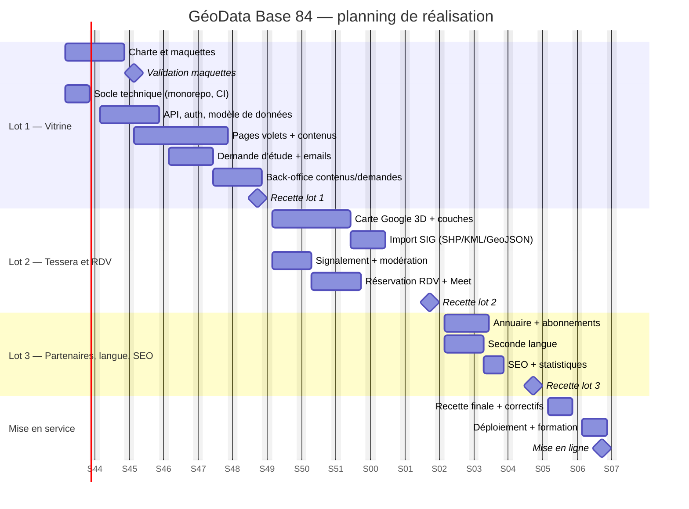
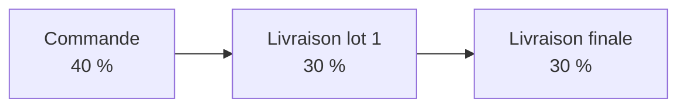

# 9. Planning et lots

[← Sommaire](README.md)

Durée totale : **16 semaines** à compter de l'acompte et de la réception des contenus. Chaque lot est validé par la cliente sous 5 jours ouvrés ; tout retard de validation ou de contenu décale d'autant la livraison.

Les dates sont indicatives (départ supposé le 2 novembre 2026) et seront recalées sur la date réelle de l'acompte.

## Contenu des lots

| Lot | Contenu | Montant HT (proforma) |
| --- | --- | --- |
| 1 | Maquettes (offertes), pages vitrine, API + base, demande d'étude, back-office | 760 000 DA |
| 2 | Carte Google 3D, signalement, réservation de RDV | 470 000 DA |
| 3 | Partenaires, seconde langue (offerte), SEO et statistiques | 170 000 DA |
| Mise en service | Déploiement Google Cloud, CI/CD, formation | 90 000 DA |
| **Total** | | **1 490 000 DA HT** |

## Jalons de paiement

## Définition de « terminé » pour chaque fonctionnalité

- Le comportement décrit dans sa fiche est implémenté et ses critères d'acceptation sont vérifiés.
- Responsive testé sur mobile (375 px), tablette et bureau.
- Textes en français en place ; clés de traduction prêtes pour la seconde langue.
- Tests unitaires sur les règles métier, test e2e sur le parcours principal.
- Déployé en recette et présenté à la cliente.
