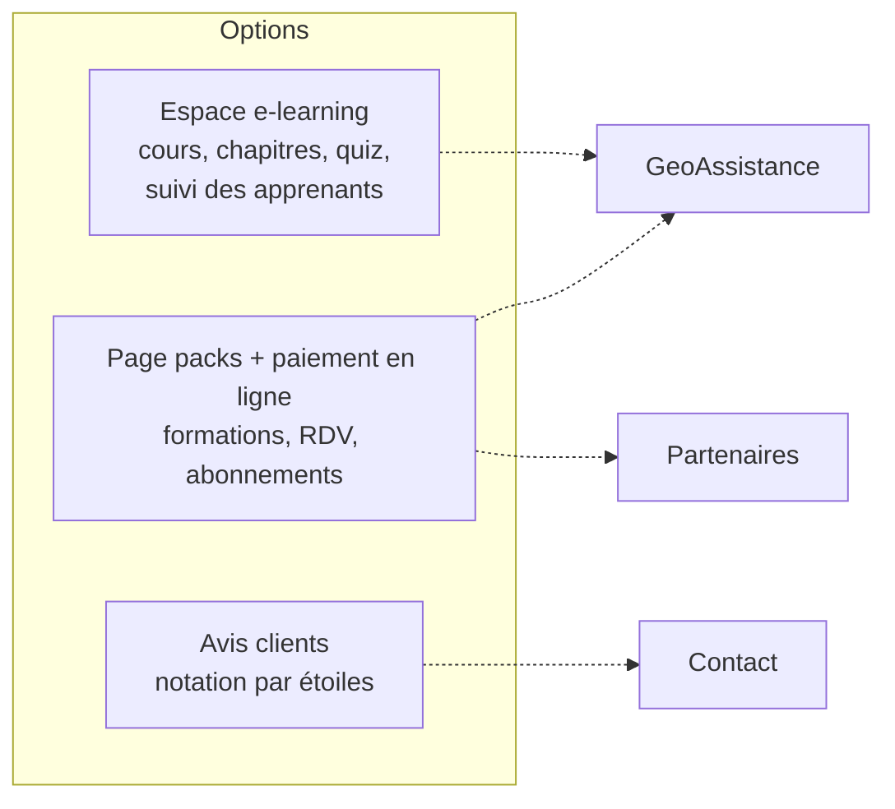

# 10. Points ouverts

[← Sommaire](README.md)

À trancher avec la cliente avant ou pendant le lot 1.

| # | Question | Impact | Lot |
| --- | --- | --- | --- |
| 1 | Contenu de la vidéo d'inspiration et corrections attendues sur les formulaires actuels (carte et services) | Design, formulaires | 1 |
| 2 | Seconde langue : anglais ou arabe ? | L'arabe impose une mise en page de droite à gauche | 3 |
| 3 | Logo vectoriel, couleurs officielles, photos de la page IZIRA | Charte | 1 |
| 4 | « À propos » et « Moi » : deux pages ou fusion avec IZIRA ? | Arborescence | 1 |
| 5 | Normes de la section 02 de BatiRecycle à vérifier avant publication | Section publiée en brouillon d'ici là | 1 |
| 6 | Couches de la carte Tessera : qui les fournit, quels formats, quelles zones ? | Lot 2 bloqué sans données | 2 |
| 7 | Paiement : devis manuel uniquement, ou paiement en ligne (formations, RDV, abonnements) ? | Ajout d'une passerelle (CIB / Edahabia / Stripe) | Option |
| 8 | E-learning : simple demande d'inscription ou espace apprenant (cours, quiz, suivi) ? | Module supplémentaire important | Option |
| 9 | Formules et tarifs de l'abonnement partenaires | Paramétrage | 3 |
| 10 | Hébergement et domaine actuels, reprise de l'ancien site et redirections | Mise en service | MS |
| 11 | Coordonnées affichées (email, téléphone, adresse) et réseaux sociaux | Pied de page, contact | 1 |
| 12 | Validation des RDV : automatique ou manuelle ? Durée des séances ? Horaires ? | Module RDV | 2 |
| 13 | Signalements : publication sur la carte après modération, ou visibles uniquement en interne ? | Tessera | 2 |
| 14 | Hébergement des données hors d'Algérie : acceptable pour la cliente ? Déclaration ANPDP ? | Conformité | 1 |

## Options identifiées (hors proforma actuelle)

Ces fonctions figurent chez un prestataire concurrent et pourraient être attendues :

