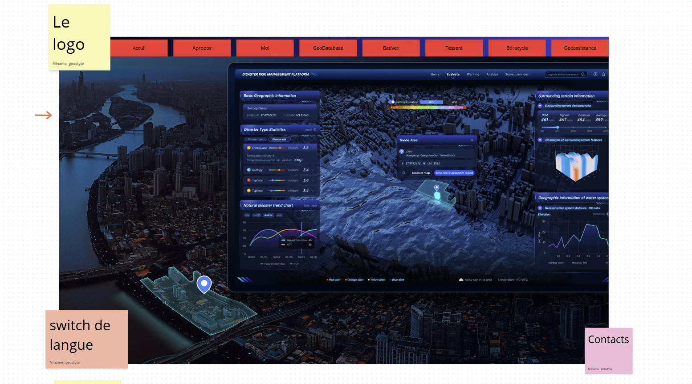
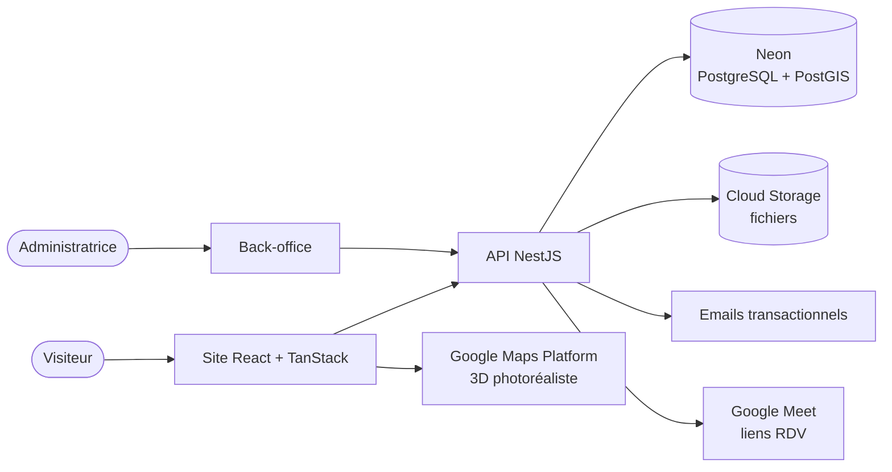

# GéoData Base 84 — Dossier de conception

> **Comprendre le terrain, valoriser la donnée et construire l'avenir.**

Ce dossier décrit, fonctionnalité par fonctionnalité, la plateforme web GéoData Base 84 : ce que chaque écran fait, comment les données circulent et comment l'application est construite. Il complète le cahier des charges et la proforma (PF-2026-001).

## Fiche projet

| | |
| --- | --- |
| Cliente | Mme Meriem Izira Ihamouchen — GéoData Base 84 / Data Sol |
| Type | Plateforme vitrine + prise de commande + cartographie interactive |
| Front-end | React 19 + TanStack (Router, Query, Form, Table), Vite, TypeScript |
| Back-end | NestJS (Node.js, TypeScript), API REST, JWT |
| Base de données | Neon — PostgreSQL serverless + PostGIS |
| Cartographie | Google Maps Platform — 3D photoréaliste (vue Google Earth) + Maps JS API |
| Hébergement | Google Cloud — Cloud Run, Cloud Storage, Cloud CDN, Secret Manager |
| Délai | 16 semaines, 3 lots + mise en service |

## Sommaire

### Vue d'ensemble
1. [Vision, publics et périmètre](01-vision-et-perimetre.md)
2. [Arborescence et parcours utilisateurs](02-arborescence-et-parcours.md)
3. [Architecture technique](03-architecture-technique.md)
4. [Modèle de données](04-modele-de-donnees.md)
5. [API REST](05-api.md)
6. [Design system et direction artistique](06-design-system.md)
7. [Sécurité, performance et conformité](07-securite-performance.md)
8. [Déploiement et environnements](08-deploiement.md)
9. [Planning et lots](09-planning-lots.md)
10. [Points ouverts](10-points-ouverts.md)

### Pages (volets)
| Page | Fichier | Lot |
| --- | --- | --- |
| Accueil | [fonctionnalites/accueil.md](fonctionnalites/accueil.md) | 1 |
| À propos | [fonctionnalites/a-propos.md](fonctionnalites/a-propos.md) | 1 |
| Moi — IZIRA | [fonctionnalites/izira.md](fonctionnalites/izira.md) | 1 |
| GéoDataBase | [fonctionnalites/geodatabase.md](fonctionnalites/geodatabase.md) | 1 |
| BatiVex | [fonctionnalites/bativex.md](fonctionnalites/bativex.md) | 1 |
| Tessera | [fonctionnalites/tessera.md](fonctionnalites/tessera.md) | 2 |
| BatiRecycle | [fonctionnalites/batirecycle.md](fonctionnalites/batirecycle.md) | 1 |
| GeoAssistance | [fonctionnalites/geoassistance.md](fonctionnalites/geoassistance.md) | 1 |
| Contact | [fonctionnalites/contact.md](fonctionnalites/contact.md) | 1 |

### Modules partagés
| Module | Fichier | Lot |
| --- | --- | --- |
| Fiches prestations & « Demander une étude » | [modules/demande-etude.md](modules/demande-etude.md) | 1 |
| Réservation de rendez-vous | [modules/rendez-vous.md](modules/rendez-vous.md) | 2 |
| Carte interactive Google 3D | [modules/carte-3d.md](modules/carte-3d.md) | 2 |
| Signalement d'un risque | [modules/signalement-risque.md](modules/signalement-risque.md) | 2 |
| Partenaires et abonnements | [modules/partenaires.md](modules/partenaires.md) | 3 |
| Multilingue | [modules/multilingue.md](modules/multilingue.md) | 3 |
| Authentification et rôles | [modules/auth-roles.md](modules/auth-roles.md) | 1 |
| Back-office | [modules/back-office.md](modules/back-office.md) | 1 |
| Notifications email | [modules/notifications.md](modules/notifications.md) | 1 |

## Vue d'ensemble en un schéma

## Conventions de ce dossier

- Les diagrammes sont en **Mermaid** : ils s'affichent directement sur GitHub, GitLab, VS Code (extension Markdown Preview Mermaid) et Notion.
- Les maquettes fil de fer sont en blocs de texte : elles indiquent la disposition, pas le style final.
- Les textes des pages viennent des documents fournis par la cliente ; ils ne sont pas réécrits ici, seulement résumés.
- Chaque fiche de fonctionnalité suit le même plan : objectif, contenu, maquette, comportement, données, critères d'acceptation.
