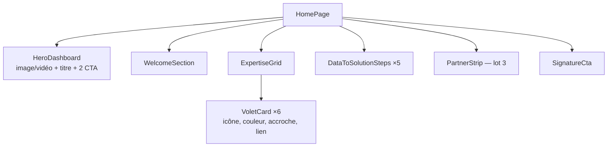

# Accueil

[← Sommaire](../README.md) · Lot 1 · Route `/$lang`

## Objectif

Donner en 10 secondes l'identité de la plateforme (géospatial, risques, construction durable) et orienter le visiteur vers le bon volet ou vers une demande.


## Contenu (textes fournis)

| Bloc | Contenu |
| --- | --- |
| Hero | « L'innovation géospatiale au service des territoires, des infrastructures et de l'environnement. » |
| Bienvenue | Présentation : géologie, géotechnique, SIG, télédétection, analyse de données, outils d'aide à la décision |
| Nos expertises | Une carte cliquable par volet (6) |
| De la donnée à la solution | 5 enjeux : prévention des risques, aménagement, connaissance du sous-sol, construction, valorisation des ressources |
| Signature | « Comprendre le terrain, valoriser la donnée et construire l'avenir. » |

## Maquette fil de fer

```
┌──────────────────────────────────────────────────────────────────┐
│ [LOGO] Accueil À propos Moi GéoDataBase BatiVex Tessera … [FR][✉]│
├──────────────────────────────────────────────────────────────────┤
│░░░░░░░░░░░░░░ VISUEL TABLEAU DE BORD 3D (fond sombre) ░░░░░░░░░░░│
│░  L'innovation géospatiale au service                          ░│
│░  des territoires, des infrastructures                         ░│
│░  et de l'environnement.                                       ░│
│░  [Demander une étude]  [Explorer la carte Tessera →]          ░│
│░░░░░░░░░░░░░░░░░░░░░░░░░░░░░░░░░░░░░░░░░░░░░░░░░░░░░░░░░░░░░░░░░│
├──────────────────────────────────────────────────────────────────┤
│ Bienvenue chez GéoData Base 84                                   │
│ texte 2 paragraphes                      [ chiffres clés ? ]     │
├──────────────────────────────────────────────────────────────────┤
│ Nos expertises, une vision intégrée                              │
│ ┌──────────┐ ┌──────────┐ ┌──────────┐                           │
│ │GéoDataBase│ │ BatiVex  │ │ Tessera  │                          │
│ └──────────┘ └──────────┘ └──────────┘                           │
│ ┌──────────┐ ┌──────────┐ ┌──────────┐                           │
│ │BatiRecycle│ │GeoAssist.│ │  IZIRA   │                          │
│ └──────────┘ └──────────┘ └──────────┘                           │
├──────────────────────────────────────────────────────────────────┤
│ De la donnée à la solution                                       │
│  ◉ Risques ─ ◉ Aménagement ─ ◉ Sous-sol ─ ◉ Construction ─ ◉ Ress.│
├──────────────────────────────────────────────────────────────────┤
│ Partenaires (logos défilants — lot 3)                            │
├──────────────────────────────────────────────────────────────────┤
│ « Comprendre le terrain, valoriser la donnée… »  [Nous contacter]│
└──────────────────────────────────────────────────────────────────┘
```

## Composition



## Comportement

- Le hero peut être une image fixe ou une courte vidéo en boucle (sans son, < 3 Mo, image de remplacement sur mobile et en mode économie de données).
- Les cartes de volet utilisent la couleur d'accent du volet ([design system](../06-design-system.md)).
- Les textes sont éditables dans le back-office (table `PAGE_CONTENT`, clé `home`).
- La bande partenaires n'apparaît que s'il existe au moins un partenaire « mis en avant ».

## Données

`GET /pages/home` (blocs de texte) + `GET /volets` (cartes) + `GET /partners?featured=true`.

## Critères d'acceptation

- [ ] Le titre du hero et les deux boutons sont visibles sans défiler sur un écran 1366×768 et sur mobile 375×667.
- [ ] Chaque carte de volet mène à la bonne page.
- [ ] LCP < 2,5 s en 4G simulée.
- [ ] Le hero respecte `prefers-reduced-motion`.
