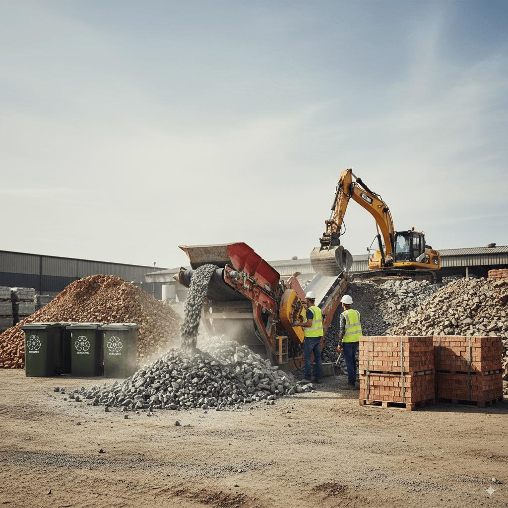
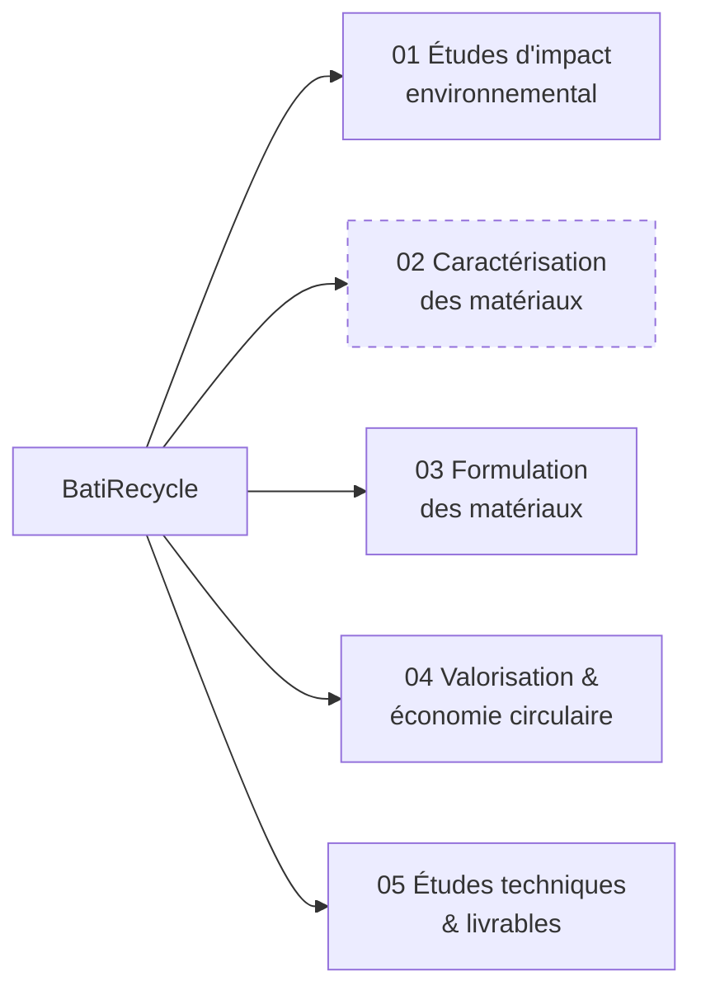
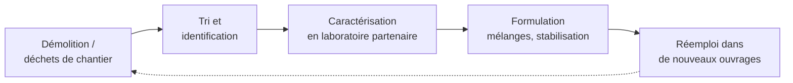

# BatiRecycle — Études d'impact, matériaux et formulation

[← Sommaire](../README.md) · Lot 1 · Routes `/$lang/batirecycle`, `/$lang/batirecycle/$prestation`

## Objectif

Volet dédié aux études d'impact environnemental, à la caractérisation et à la formulation des matériaux, et à la valorisation des déchets du BTP. Public : entreprises du BTP, laboratoires, BET, industriels, porteurs de projets.

## Les 5 sections

*Section 02 en pointillé : publiée en brouillon tant que la cliente n'a pas vérifié les normes.*

| Section | Sous-groupes | Exemples |
| --- | --- | --- |
| 01 Impact | Diagnostics ; suivi et gestion | Études documentaires de sites, inventaire des sources de pollution, matrices d'impacts, cartes des zones sensibles |
| 02 Caractérisation | Matériaux recyclés et alternatifs | Déchets minéraux valorisables, granulats recyclés, réemploi, comparaison naturel/recyclé |
| 03 Formulation | Mélanges ; stabilisation des sols | Optimisation granulométrique, sol–chaux / sol–ciment, interprétation Proctor et CBR |
| 04 Valorisation | — | Diagnostic du potentiel, filières, scénarios de gestion des déchets, fiches techniques |
| 05 Livrables | — | Rapports de caractérisation, tableaux de formulations, matrices, cartes, dossiers pour BET |

## Cycle de valorisation (illustration de la page)

## Comportement

- Gabarit commun des volets ; les sections s'affichent en blocs numérotés 01 à 05.
- Prestations « en partenariat avec un laboratoire compétent » : drapeau `requires_partner`, partenaires affichés.
- Statut de publication par section : `DRAFT` masqué au public, visible en aperçu dans le back-office.

## Critères d'acceptation

- [ ] Les 5 sections et toutes les puces fournies sont présentes.
- [ ] La section 02 peut être publiée ou masquée depuis le back-office.
- [ ] Chaque prestation ouvre la demande d'étude.
