# BatiVex — Construction, génie civil et expertise technique

[← Sommaire](../README.md) · Lot 1 (RDV au lot 2) · Routes `/$lang/bativex`, `/$lang/bativex/$prestation`

## Objectif

Volet dédié au bâtiment, au génie civil, à la géotechnique et aux matériaux : accompagnement technique, analyse et aide à la décision pour étudiants, professionnels du BTP, BET et porteurs de projets.

## Catalogue — 20 domaines regroupés en 3 blocs

```mermaid
flowchart TB
  BV[BatiVex]
  BV --> S[Sols et essais]
  BV --> D[Données et interprétation]
  BV --> A[Accompagnement et livrables]

  S --> S1[Identification des sols]
  S --> S2[Classification géotechnique]
  S --> S3[Interprétation essais labo]
  S --> S4[Propriétés physiques et mécaniques]
  S --> S5[Tassements et compressibilité]
  S --> S6[Stabilité des talus — initiation]
  S --> S7[Interprétation essais in situ]

  D --> D1[Étude documentaire du sol]
  D --> D2[Analyse des sondages existants]
  D --> D3[Synthèse des essais]
  D --> D4[Logs lithologiques]
  D --> D5[Coupes géotechniques]
  D --> D6[Contraintes du terrain]

  A --> A1[Préparation des études]
  A --> A2[Assistance à l'interprétation]
  A --> A3[Rapports techniques]
  A --> A4[Fiches labo et chantier]
  A --> A5[Structuration des données]
  A --> A6[Outils numériques BTP]
  A --> A7[Dossiers et présentations]
```



## Demande explicite de la cliente : prise de RDV

« booking rdv avec modalité en présentiel ou en ligne · le choix du service · livrable attendu »

```
┌───────────────────────────────────────────────────────────┐
│ Prendre rendez-vous — BatiVex                              │
├───────────────────────────────────────────────────────────┤
│ 1. Service                                                │
│    [ Interprétation des essais de laboratoire       ▾ ]   │
│ 2. Modalité                                               │
│    (•) En ligne       ( ) Présentiel                      │
│ 3. Créneau                                                │
│    ◀ Novembre 2026 ▶                                      │
│    Lu  Ma  Me  Je  Ve                                     │
│     2   3   4   5   6   → 09:00  10:00  14:00  15:00      │
│ 4. Livrable attendu                                       │
│    [ Synthèse des résultats d'essais               ▾ ]    │
│    Précisions : [______________________________]          │
│    Fichiers    : [ Déposer vos rapports ]                 │
│ 5. Vos coordonnées                                        │
│    Nom [____]  Email [____]  Tél [____]  ☐ Consentement   │
│                                        [Confirmer le RDV] │
└───────────────────────────────────────────────────────────┘
```

Détail du fonctionnement : [module Rendez-vous](../modules/rendez-vous.md).

## Comportement

- Chaque domaine peut ouvrir soit une **demande d'étude** (travail livré), soit un **RDV** (échange, assistance) : la fiche affiche les deux boutons.
- Les livrables proposés dans le RDV dépendent du service choisi (liste paramétrable).
- Le module RDV est livré au lot 2 ; au lot 1, le bouton ouvre la demande d'étude avec le type « RDV souhaité ».

## Critères d'acceptation

- [ ] Les 20 domaines fournis sont présents, regroupés en 3 blocs.
- [ ] Le formulaire RDV propose modalité, service et livrable attendu.
- [ ] Un RDV en ligne génère un lien de visioconférence dans l'email.
