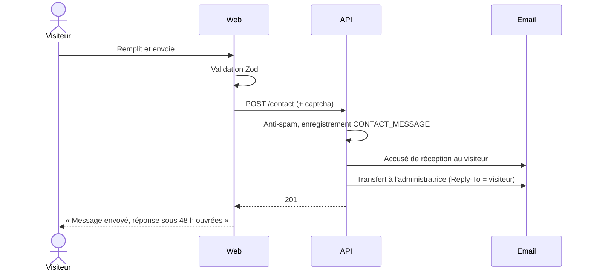

# Contact

[← Sommaire](../README.md) · Lot 1 · Route `/$lang/contact`

## Contenu (texte fourni)

> 📩 Contactez-nous — Une question, une collaboration ou un projet à partager ? L'équipe GéoData Base 84 est à votre écoute pour vous accompagner dans vos besoins en géosciences, BTP, innovation, gestion des risques et aménagement durable.

## Maquette fil de fer

```
┌──────────────────────────────────────────────────────────────┐
│ Contactez-nous                                               │
│ texte d'introduction                                         │
├────────────────────────────────┬─────────────────────────────┤
│ Nom *        [____________]    │ ✉ contact@…                 │
│ Email *      [____________]    │ ☎ +213 …                    │
│ Téléphone    [____________]    │ 📍 Adresse                  │
│ Organisme    [____________]    │                             │
│ Volet        [ Tessera    ▾]   │ (in) (ig) (fb)              │
│ Objet *      [____________]    │                             │
│ Message *    [            ]    │ ┌─────────────────────────┐ │
│              [            ]    │ │ Besoin d'une étude ?     │ │
│ ☐ J'accepte… *                 │ │ [Demander une étude →]   │ │
│                    [Envoyer]   │ └─────────────────────────┘ │
└────────────────────────────────┴─────────────────────────────┘
```

## Comportement



- Le champ « Volet » permet de router le message (filtre en back-office).
- Si le visiteur décrit un besoin d'étude, un encart l'oriente vers le formulaire dédié, plus complet.

## Critères d'acceptation

- [ ] Message reçu par l'administratrice avec possibilité de répondre directement.
- [ ] Accusé de réception envoyé au visiteur.
- [ ] Messages consultables et archivables dans le back-office.
