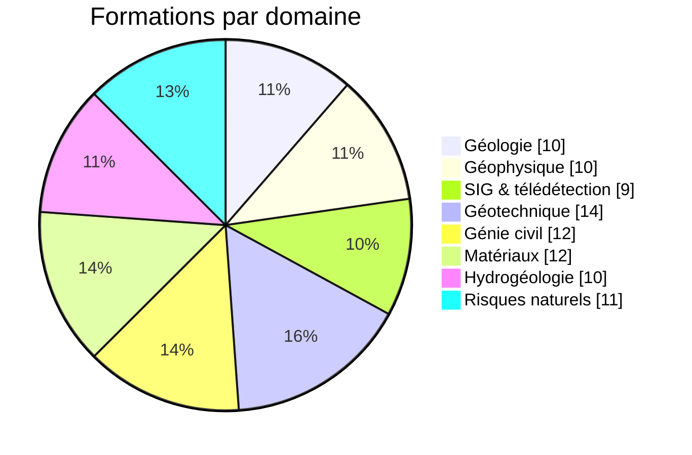
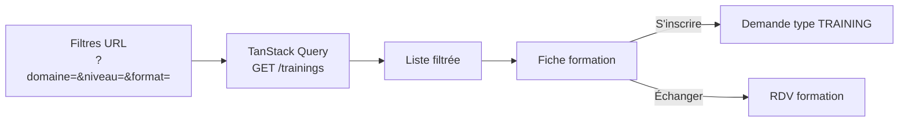

# GeoAssistance — Espace de formation

[← Sommaire](../README.md) · Lot 1 · Routes `/$lang/geoassistance`, `/$lang/geoassistance/$formation`


> « Formation • Expertise technique • Compétences professionnelles » — « Apprendre, pratiquer et développer son expertise. »

## Objectif

Rendre les connaissances accessibles : formations structurées, supports, exercices et études de cas, de l'étudiant au professionnel.

## Catalogue — 88 formations



| Domaine | Exemples |
| --- | --- |
| Géologie | Cartographie et levés de terrain, pétrologie, stratigraphie, géologie marine, prospection |
| Géophysique | Prospection électrique, ERT, sismique, électromagnétisme, diagraphies |
| SIG & télédétection | QGIS, ArcGIS, géoréférencement, bases géographiques, MNT, imagerie satellite |
| Géotechnique | Mécanique des sols et des roches, essais in situ et labo, fondations, talus, géotechnique routière |
| Génie civil | Lecture de plans, coffrage/ferraillage, métré, structures, pathologies, BIM |
| Matériaux | Granulats, essais de compression, formulation des bétons, Proctor/CBR, bleu de méthylène, recyclage |
| Hydrogéologie | Aquifères, essais de pompage, piézométrie, vulnérabilité, modélisation |
| Risques naturels | Aléa sismique, failles actives, microzonage, glissements, inondations, cartographie de vulnérabilité |

## Écran catalogue — fil de fer

```
┌──────────────────────────────────────────────────────────────┐
│ GeoAssistance — Espace de formation                          │
│ [Rechercher une formation…]                                  │
│ Domaine [Tous ▾]  Niveau [Tous ▾]  Format [Tous ▾]           │
├──────────────────────────────────────────────────────────────┤
│ ┌─────────────────┐ ┌─────────────────┐ ┌─────────────────┐  │
│ │ GÉOTECHNIQUE    │ │ SIG             │ │ MATÉRIAUX       │  │
│ │ Essais Proctor  │ │ Prise en main   │ │ Formulation des │  │
│ │ et CBR          │ │ de QGIS         │ │ bétons          │  │
│ │ Débutant · 12 h │ │ Débutant · 16 h │ │ Interm. · 20 h  │  │
│ │ En ligne        │ │ Hybride         │ │ Présentiel      │  │
│ │ [S'inscrire]    │ │ [S'inscrire]    │ │ [S'inscrire]    │  │
│ └─────────────────┘ └─────────────────┘ └─────────────────┘  │
│ … pagination / chargement progressif                         │
├──────────────────────────────────────────────────────────────┤
│ Ateliers pratiques & projets : exercices guidés, études de   │
│ cas réels, mini-projets, logiciels professionnels            │
└──────────────────────────────────────────────────────────────┘
```

## Comportement



- Les filtres sont dans l'URL : une recherche filtrée est partageable et indexable.
- Inscription = demande de type `TRAINING` (pas de compte apprenant dans le périmètre actuel).
- Niveau, format et durée sont renseignés par la cliente dans le back-office ; à défaut, les champs sont masqués.

## Évolution possible (option)

Espace e-learning complet : comptes apprenants, modules et chapitres, vidéos, quiz, suivi de progression, forum. Hors proforma — voir [points ouverts](../10-points-ouverts.md).

## Critères d'acceptation

- [ ] Les 88 formations fournies sont saisies et filtrables.
- [ ] Les filtres se combinent et se reflètent dans l'URL.
- [ ] L'inscription crée une demande visible en back-office.
