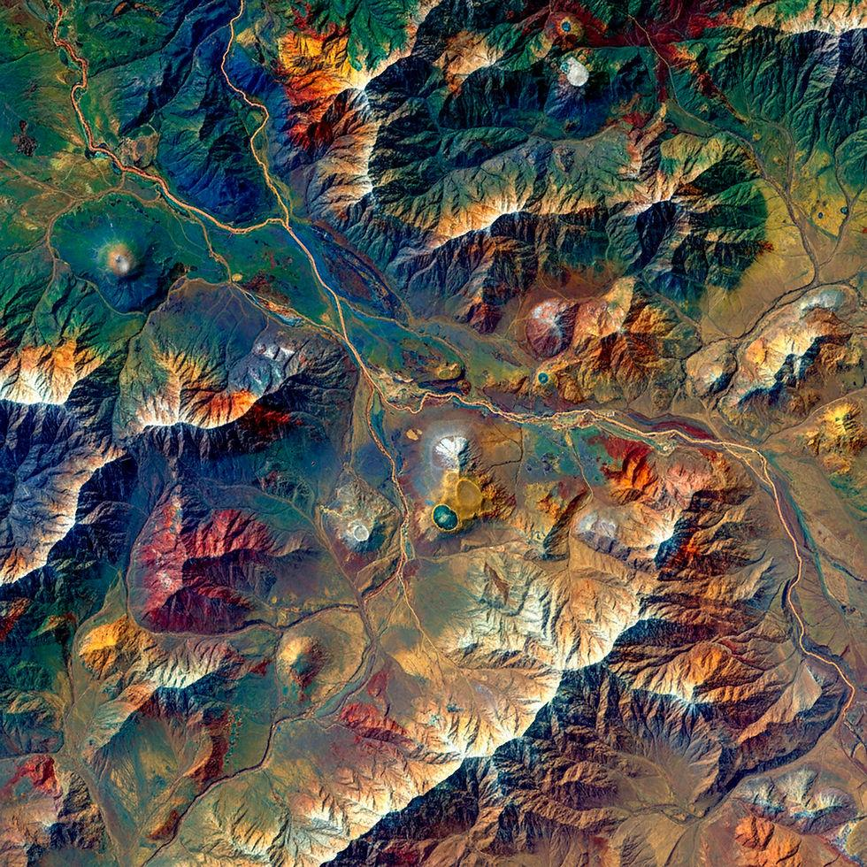
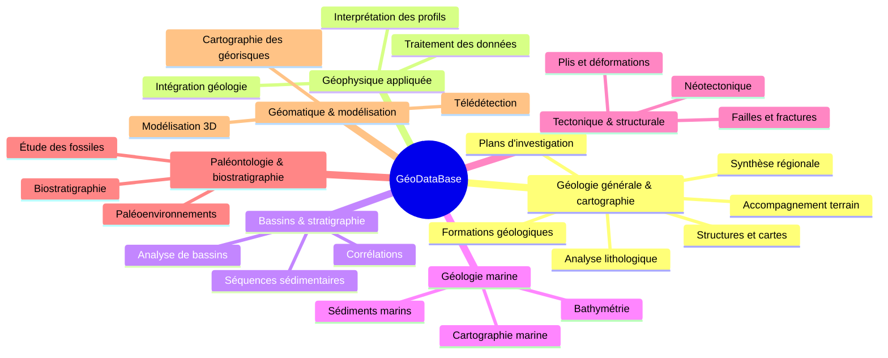
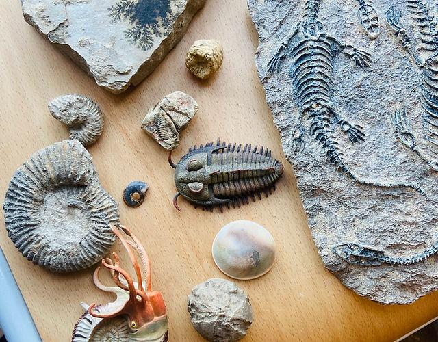
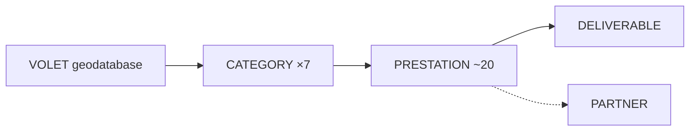

# GéoDataBase — Nos services en géosciences

[← Sommaire](../README.md) · Lot 1 · Routes `/$lang/geodatabase`, `/$lang/geodatabase/$categorie/$prestation`



## Objectif

Présenter le cœur scientifique de l'offre et transformer chaque prestation en demande d'étude localisée.

> Sous-titre : « Expertise scientifique · Analyse des données · Cartographie · Modélisation géologique »

## Catalogue





## Fiche prestation (exigence de la cliente)

Chaque prestation a sa fiche avec **coordonnées du site**, **livrables possibles** et bouton **« Demander une étude »**.

```
┌──────────────────────────────────────────────────────────────┐
│ GéoDataBase › Tectonique › Analyse des failles et fractures  │
├──────────────────────────────────────────────────────────────┤
│ Analyse des failles et des fractures                         │
│ Description (2–4 paragraphes)                                │
│                                                              │
│ Livrables possibles                                          │
│  ☐ Carte   ☐ Coupe   ☐ Base de données   ☐ Modèle   ☐ Rapport│
│                                                              │
│ ⓘ Réalisée en partenariat avec un laboratoire (si concerné)  │
│   [logo partenaire]                                          │
│                                                              │
│ Où se situe votre site ?                                     │
│ ┌──────────────────────────────┐                             │
│ │  mini-carte : pointer / zone │  Lat 36.7538  Long 3.0588   │
│ └──────────────────────────────┘                             │
│                                  [Demander une étude →]      │
├──────────────────────────────────────────────────────────────┤
│ Prestations proches : …                                      │
└──────────────────────────────────────────────────────────────┘
```

Le choix de livrables et la localisation saisis sur la fiche sont transmis au formulaire de demande (pré-remplissage).

## Comportement

- Navigation par ancres ou onglets entre les 7 catégories ; URL partageable par catégorie.
- Les prestations qui demandent équipements, campagnes de terrain ou essais spécialisés portent le drapeau `requires_partner` et affichent le ou les partenaires associés.
- Données structurées `Service` (schema.org) sur chaque fiche pour le référencement.

## Données



## Critères d'acceptation

- [ ] Les 7 catégories et toutes les prestations fournies sont présentes.
- [ ] Chaque fiche a ses livrables, sa mini-carte et son bouton de demande.
- [ ] La demande arrive en back-office avec la prestation, la localisation et les livrables.
