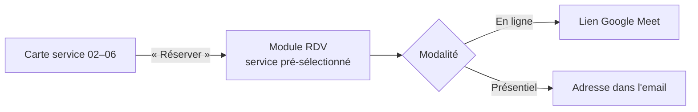

# Moi — IZIRA, Expertise & Accompagnement

[← Sommaire](../README.md) · Lot 1 (+ RDV au lot 2) · Route `/$lang/izira`

## Objectif

Espace personnel de la fondatrice : son parcours et ses services de coaching, formation et accompagnement entrepreneurial, avec réservation de séance.

> Accroche : « Transformer les idées en projets, les compétences en opportunités et les ambitions en réalisations concrètes. »

## Contenu

| N° | Section | Contenu |
| --- | --- | --- |
| 01 | À propos de moi | Biographie de Meriem Izira Ihamouchen (géotechnique, SIG, BTP, architecture, design d'intérieur, aménagement), liens Instagram et LinkedIn |
| 02 | Coaching entrepreneurial | Clarification des idées, structuration, compétences, préparation au lancement |
| 03 | Formation & Mentorat | Formations, ateliers, mentorat, accompagnement des étudiants |
| 04 | Accompagnement des porteurs de projets | Faisabilité, modèle économique, proposition de valeur, financement |
| 05 | Études & Stratégie commerciale | Études de marché, concurrence, business plans, positionnement |
| 06 | Gestion de projets & Communication | Planification, présentations, négociation, valorisation |
| — | Domaines d'intervention | 8 puces |
| — | Mission | « vous aider à structurer vos idées… » |
| — | Galerie | Photos fournies par la cliente |

## Maquette fil de fer

```
┌────────────────────────────────────────────────────────────┐
│ ┌──────────┐  IZIRA — Expertise & Accompagnement           │
│ │  PHOTO   │  Transformer les idées en projets…            │
│ │ portrait │  [Réserver une séance]   (in) (ig)            │
│ └──────────┘                                               │
├────────────────────────────────────────────────────────────┤
│ 01 À propos de moi — biographie                            │
├────────────────────────────────────────────────────────────┤
│ ┌─02 Coaching─┐ ┌─03 Formation─┐ ┌─04 Porteurs─┐           │
│ │ texte       │ │ texte        │ │ texte       │           │
│ │ [Réserver]  │ │ [Réserver]   │ │ [Réserver]  │           │
│ └─────────────┘ └──────────────┘ └─────────────┘           │
│ ┌─05 Études───┐ ┌─06 Projets───┐                           │
│ └─────────────┘ └──────────────┘                           │
├────────────────────────────────────────────────────────────┤
│ Mes domaines d'intervention  •••  │  Ma mission (citation) │
├────────────────────────────────────────────────────────────┤
│ Galerie  [img][img][img][img]  → lightbox                  │
└────────────────────────────────────────────────────────────┘
```

## Comportement



- Chaque service 02 à 06 correspond à une ligne `SERVICE_OFFER` (durée, prix indicatif facultatif, modalités autorisées).
- La galerie est gérée dans le back-office (upload, ordre, légende).
- Les liens réseaux sociaux s'ouvrent dans un nouvel onglet (`rel="noopener"`).

## Critères d'acceptation

- [ ] Les 6 sections et la galerie sont éditables.
- [ ] Le bouton « Réserver » ouvre le module RDV avec le bon service.
- [ ] Les liens Instagram et LinkedIn fournis fonctionnent.
