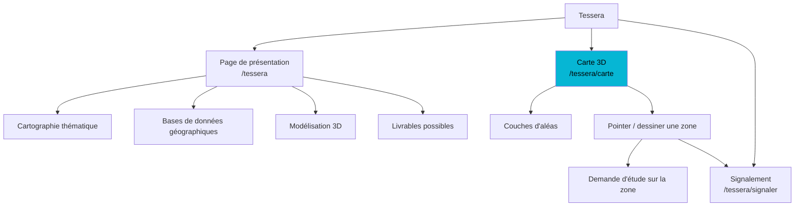
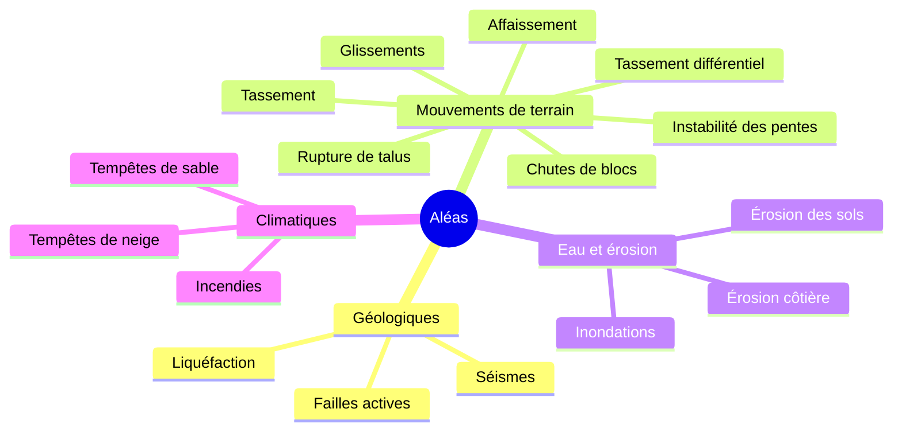

# Tessera — Intelligence territoriale & solutions géospatiales

[← Sommaire](../README.md) · Lot 2 · Routes `/$lang/tessera`, `/$lang/tessera/carte`, `/$lang/tessera/signaler`

> « Transformez les données en décisions. »


## Objectif

Le seul volet **dynamique** : il combine géorisques, microzonage et cartographie numérique. Il sert de vitrine technique et de porte d'entrée des demandes localisées.

Exigences de la cliente :
1. **une carte** ;
2. **un formulaire** avec les coordonnées de la zone ;
3. **3 catégories de services** ;
4. **signalement d'un risque** (fonction existante à corriger) ;
5. les aléas suivants à couvrir.

## Structure du volet



## Les 3 catégories de services

### 1. Cartographie thématique

| Carte | Contenu |
| --- | --- |
| Géologique | Lithologie, formations, structures tectoniques, failles |
| Hydrologique | Réseaux hydrographiques, bassins versants, drainage, écoulements, zones d'accumulation |
| Hydrogéologique | Aquifères, niveaux piézométriques, sources, recharge, vulnérabilité des nappes |
| Géomorphologique | Relief, unités morphologiques, formes et évolution des paysages |
| Géotechnique | Nature des sols, formations superficielles, propriétés, aptitude à la construction |
| Géophysique | Anomalies, résistivité électrique, données magnétiques |
| Aléas naturels | Voir la liste complète ci-dessous |
| Ressources naturelles | Minérales, matériaux de construction, eau, zones d'intérêt géologique |

### 2. Structuration et gestion des bases de données géographiques

Conception · harmonisation · organisation des bases géoscientifiques · contrôle qualité (géométrie, topologie, attributs) · référentiels (infrastructures, réseaux, limites administratives) · nettoyage (doublons, géométries invalides, incohérences).

### 3. Modélisation 3D

MNT · MNS · modélisation 3D du relief · cartes 3D · occupation du sol en 3D · infrastructures et réseaux · profils topographiques et coupes · analyse des pentes et expositions · visualisation multi-couches · scénarios d'aménagement · supports 3D (vues, rendus, animations).

Services transverses : cartes thématiques numériques, géoréférencement et vectorisation, analyse spatiale SIG, imagerie satellitaire, cartes de susceptibilité, de vulnérabilité et d'aléas.

### Livrables possibles
Bases de données structurées · couches SIG nettoyées · géodatabases · dictionnaire de données · rapport de contrôle qualité · métadonnées · données prêtes pour l'analyse.

## Aléas couverts




*Référence de style pour les légendes : classes de très faible à très élevé, mêmes couleurs sur la carte et dans la légende.*

## Écran carte — fil de fer

```
┌──────────────────────────────────────────────────────────────────────┐
│ [≡ Couches]  🔍 Adresse, commune ou « 36.75, 3.05 »   [2D|3D] [⛶]    │
├────────────┬─────────────────────────────────────────────────────────┤
│ COUCHES    │                                                         │
│ ☑ Séismes  │            VUE GOOGLE 3D PHOTORÉALISTE                  │
│ ☑ Glissem. │                                                         │
│ ☐ Inondat. │        ▓▓▓ zone colorée par classe d'aléa ▓▓▓           │
│ ☐ Érosion  │                    📍 signalement publié                │
│ …          │                                                         │
│ Opacité ━●━│                                                         │
│            │  ┌─────────────────────────────┐                        │
│ LÉGENDE    │  │ Zone sélectionnée — 12,4 ha │                        │
│ ■ Très faib│  │ Aléas : glissement (élevé)  │                        │
│ ■ Faible   │  │ [Demander une étude]        │                        │
│ ■ Moyen    │  │ [Signaler un risque]        │                        │
│ ■ Élevé    │  │ [Exporter KML]              │                        │
│ ■ Très élev│  └─────────────────────────────┘                        │
├────────────┴──────────────────────┬──────────────────────────────────┤
│ Outils : 📍 Pointer  ⬠ Zone  📏 Mesurer   │  Lat 36.75381  Long 3.05882 │
└──────────────────────────────────────────────────────────────────────┘
```

Fonctionnement détaillé : [Carte interactive Google 3D](../modules/carte-3d.md) et [Signalement d'un risque](../modules/signalement-risque.md).

## Corrections demandées sur l'existant

La cliente signale des défauts sur les formulaires de la carte et des services actuels (voir vidéo). La nouvelle version les remplace par :
- un formulaire unique, pré-rempli depuis la carte ;
- une validation champ par champ avec messages clairs ;
- la liste complète des aléas ci-dessus.

## Critères d'acceptation

- [ ] La carte affiche la vue 3D et bascule en 2D.
- [ ] Les couches importées s'affichent avec leur légende.
- [ ] Une zone dessinée ouvre la demande d'étude avec la géométrie.
- [ ] Le signalement fonctionne pour tous les aléas listés.
- [ ] Les 3 catégories de services et les livrables sont présentés.
