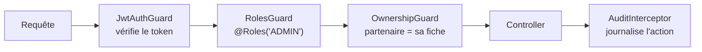

# Authentification et rôles

[← Sommaire](../README.md) · Lot 1

## Rôles

| Rôle | Peut |
| --- | --- |
| Visiteur (non connecté) | Consulter, envoyer des demandes, réserver, signaler, contacter |
| Éditeur (`EDITOR`) | Modifier volets, prestations, formations, pages, galerie |
| Administratrice (`ADMIN`) | Tout : demandes, RDV, signalements, couches, partenaires, utilisateurs, paramètres |
| Partenaire (`PARTNER`, phase 2) | Modifier sa propre fiche |

## Matrice des droits

| Ressource | Visiteur | Partenaire | Éditeur | Admin |
| --- | :---: | :---: | :---: | :---: |
| Contenus publics (lecture) | ✅ | ✅ | ✅ | ✅ |
| Volets, prestations, formations, pages | — | — | ✏️ | ✏️ |
| Demandes d'étude | créer | — | 👁 | ✏️ |
| Rendez-vous | créer | — | 👁 | ✏️ |
| Signalements | créer | — | 👁 | modérer |
| Couches carto | — | — | — | ✏️ |
| Partenaires et abonnements | — | sa fiche | — | ✏️ |
| Utilisateurs | — | — | — | ✏️ |
| Journal d'audit | — | — | — | 👁 |

## Mise en œuvre NestJS



```ts
@Controller('admin/requests')
@UseGuards(JwtAuthGuard, RolesGuard)
export class AdminRequestsController {
  constructor(private readonly requests: RequestsService) {}

  @Patch(':id/status')
  @Roles(Role.ADMIN)
  updateStatus(
    @Param('id', ParseUUIDPipe) id: string,
    @Body() dto: UpdateStatusDto,
    @CurrentUser() user: AuthUser,
  ) {
    return this.requests.changeStatus(id, dto.status, dto.comment, user.id);
  }
}
```

## Comptes

- Pas d'inscription publique : l'administratrice crée les comptes depuis le back-office ; l'utilisateur reçoit un lien pour définir son mot de passe.
- Mot de passe : 12 caractères minimum, haché en Argon2id.
- Mot de passe oublié : lien à usage unique valable 30 min.
- Double authentification (TOTP) proposée pour le compte administratrice (recommandée).

## Critères d'acceptation

- [ ] Un éditeur ne peut ni voir les données personnelles en écriture ni changer un statut.
- [ ] Toute route `/admin/*` refuse un appel sans token valide (401) ou avec un rôle insuffisant (403).
- [ ] Les actions d'administration apparaissent dans le journal d'audit.
