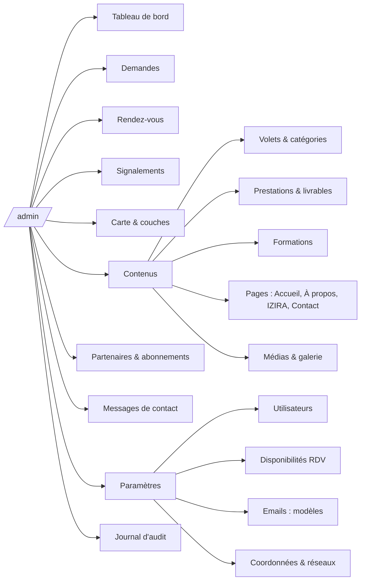
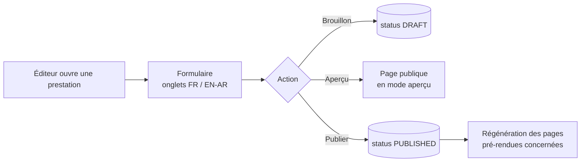

# Back-office

[← Sommaire](../README.md) · Lot 1 (modules RDV, signalements, couches au lot 2 ; partenaires au lot 3) · Route `/admin`

## Objectif

Donner à la cliente une autonomie complète : contenus, demandes, rendez-vous, couches cartographiques et partenaires, sans intervention technique.

## Plan du back-office



## Tableau de bord

```
┌──────────────────────────────────────────────────────────────────┐
│ Bonjour Meriem                                    22 oct. 2026    │
├───────────────┬───────────────┬───────────────┬──────────────────┤
│ 7 nouvelles   │ 3 RDV         │ 2 signalements│ 1 abonnement     │
│ demandes      │ aujourd'hui   │ à modérer     │ échoit sous 30 j │
├───────────────┴───────────────┴───────────────┴──────────────────┤
│ Demandes par volet (30 j)       │ Carte des demandes récentes    │
│ ▇▇▇▇▇▇ Tessera                  │  ┌──────────────────────────┐  │
│ ▇▇▇▇ BatiVex                    │  │   • • ⬠   •              │  │
│ ▇▇▇ GéoDataBase                 │  │        •      •          │  │
│ ▇▇ BatiRecycle                  │  └──────────────────────────┘  │
├─────────────────────────────────┴────────────────────────────────┤
│ Dernières demandes                                                │
│ DE-2026-0042  BET Atlas   Étude géotechnique   Alger   NOUVELLE   │
│ DE-2026-0041  Sara M.     Carte d'aléas        Médéa   EN COURS   │
└──────────────────────────────────────────────────────────────────┘
```

## Écran « Demandes »

```
┌──────────────────────────────────────────────────────────────────┐
│ Demandes   [🔍 référence, nom, email]  Statut[Tous▾] Volet[Tous▾] │
│            Du [__] au [__]                        [Exporter CSV]  │
├────────┬────────────┬──────────────┬─────────┬────────┬──────────┤
│ Réf.   │ Demandeur  │ Prestation   │ Wilaya  │ Date   │ Statut   │
├────────┼────────────┼──────────────┼─────────┼────────┼──────────┤
│ …      │ …          │ …            │ …       │ …      │ [badge]  │
└────────┴────────────┴──────────────┴─────────┴────────┴──────────┘

Détail d'une demande
┌──────────────────────────────┬───────────────────────────────────┐
│ DE-2026-0042 · NOUVELLE      │ ┌───────────────────────────────┐ │
│ BET Atlas — Karim B.         │ │ carte de la zone + aléas       │ │
│ karim@… · +213…              │ │ intersectés                    │ │
│ Prestation, livrables        │ └───────────────────────────────┘ │
│ Description                  │ Aléas détectés : glissement (élevé)│
│ Pièces jointes ⬇             │                                   │
├──────────────────────────────┴───────────────────────────────────┤
│ Statut [En cours d'analyse ▾]  ☐ Prévenir le demandeur  [Appliquer]│
│ Notes internes : …                                    [Ajouter]   │
│ Historique : NOUVELLE → EN COURS (Meriem, 22/10 10:14)            │
└──────────────────────────────────────────────────────────────────┘
```

## Édition de contenus



La publication déclenche la régénération des pages pré-rendues (webhook de build ou rendu à la demande avec invalidation de cache), pour que le site public reflète la modification en quelques minutes.

## Principes d'interface

- Construit avec TanStack Table (tri, filtres, pagination côté serveur) et les composants du design system.
- Tous les filtres sont dans l'URL (liens partageables entre éditeur et administratrice).
- Confirmation avant toute suppression ; suppression logique (corbeille 30 jours) pour les contenus.
- Utilisable sur tablette ; consultation sur mobile.

## Critères d'acceptation

- [ ] La cliente peut créer une prestation et la voir publiée sans aide.
- [ ] Les demandes se filtrent, changent de statut et s'exportent en CSV.
- [ ] Les couches s'importent et se stylent depuis l'écran « Carte & couches ».
- [ ] Une formation de 30 minutes suffit à la prise en main (guide fourni).
