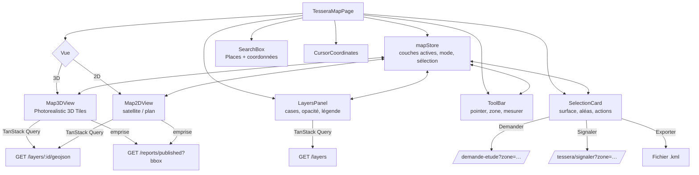
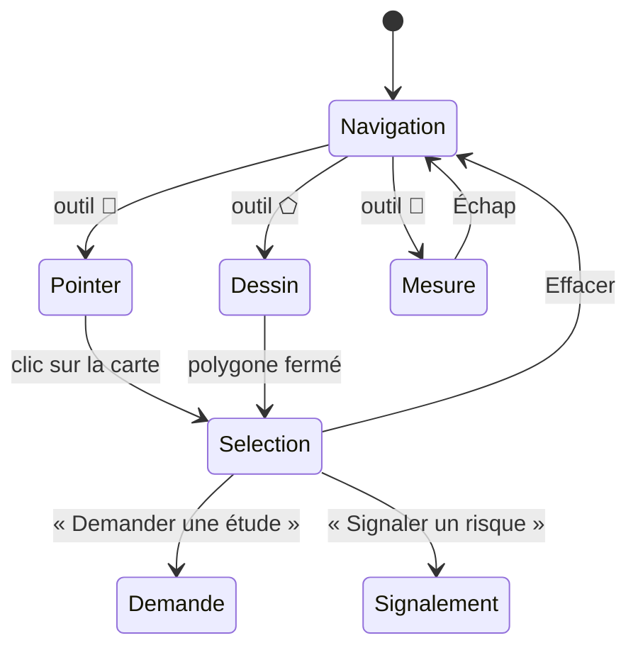
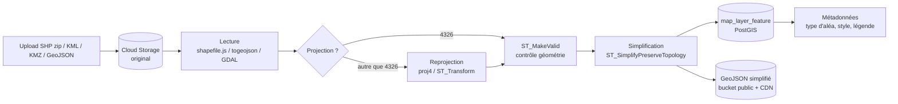

# Carte interactive Google 3D (Tessera)

[← Sommaire](../README.md) · Lot 2 · Route `/$lang/tessera/carte`

## Objectif

Offrir un rendu **type Google Earth** (globe et relief en 3D) sur lequel on superpose les couches d'aléas, on localise un site et on lance une demande ou un signalement.

## Briques Google Maps Platform

| Brique | Usage |
| --- | --- |
| Maps JavaScript API — carte 3D (`Map3DElement`, Photorealistic 3D Tiles) | Vue Google Earth : relief, rotation, inclinaison |
| Maps JavaScript API — carte 2D (vecteur) | Vue satellite / plan, plus légère, utilisée sur mobile faible et dans les formulaires |
| Data layer / Deck.gl overlay | Affichage des couches GeoJSON (polygones d'aléas) |
| Drawing (outils maison sur 2D) + Geometry library | Pointer, dessiner une zone, mesurer distances et surfaces |
| Places Autocomplete + Geocoding | Recherche d'adresses, communes ; géocodage inverse |
| Map ID (style cloud) | Style de carte cohérent avec la charte |

Les noms et disponibilités exactes des API 3D évoluent : à vérifier dans la documentation Google au démarrage du lot 2.

## Architecture du composant



## Modes d'interaction



Le dessin de polygone se fait en vue 2D (plus précis) ; la sélection reste visible quand on repasse en 3D.

## Couches cartographiques

### Import par l'administratrice



Les projections algériennes courantes (Nord Sahara 1959 / UTM 30–32N, WGS 84 / UTM) sont reconnues via le fichier `.prj` ; à défaut, l'administratrice choisit la projection dans une liste.

### Style

Chaque couche a un style JSON :

```json
{
  "property": "classe",
  "classes": [
    { "value": 1, "label": "Très faible", "color": "#9CA3AF" },
    { "value": 2, "label": "Faible",      "color": "#FACC15" },
    { "value": 3, "label": "Moyen",       "color": "#F97316" },
    { "value": 4, "label": "Élevé",       "color": "#DC2626" },
    { "value": 5, "label": "Très élevé",  "color": "#7E22CE" }
  ],
  "fillOpacity": 0.55,
  "strokeColor": "#111827",
  "strokeWidth": 0.5
}
```

## Export KML

Depuis une sélection, l'utilisateur télécharge un `.kml` (zone + aléas intersectés en attributs) qu'il ouvre dans Google Earth Pro. Génération côté navigateur (`tokml`), sans appel serveur.

## Performance et coûts

- Le script Google Maps n'est chargé que sur cette route.
- La 3D n'est activée par défaut que sur ordinateur ; sur mobile, la carte démarre en 2D avec un bouton « Passer en 3D ».
- Les GeoJSON lourds sont simplifiés à l'import ; au-delà de ~5 Mo par couche, passage à des tuiles vectorielles (évolution).
- Quota journalier et alerte à 80 % sur le compte Google Cloud de la cliente.

## Critères d'acceptation

- [ ] Vue 3D fluide (≥ 30 i/s) sur un ordinateur portable récent.
- [ ] Bascule 2D/3D sans perdre la position ni la sélection.
- [ ] Un shapefile en UTM 31N s'importe et se superpose correctement.
- [ ] Recherche d'une commune et de coordonnées « 36.75, 3.05 ».
- [ ] Surface et distances affichées en m, ha ou km selon l'échelle.
