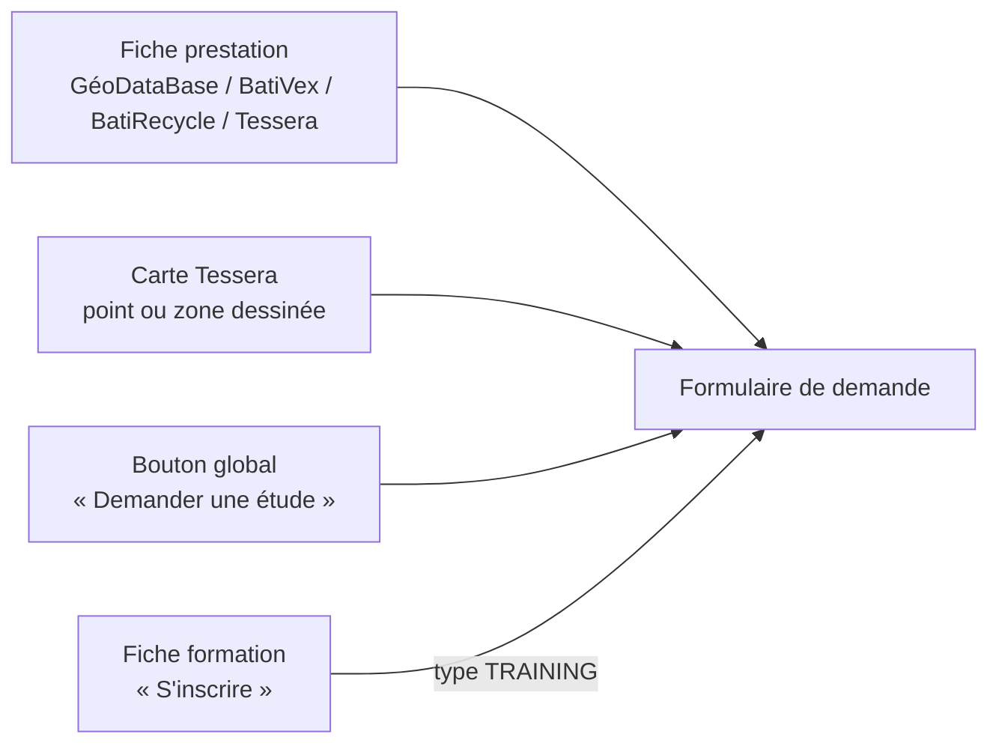
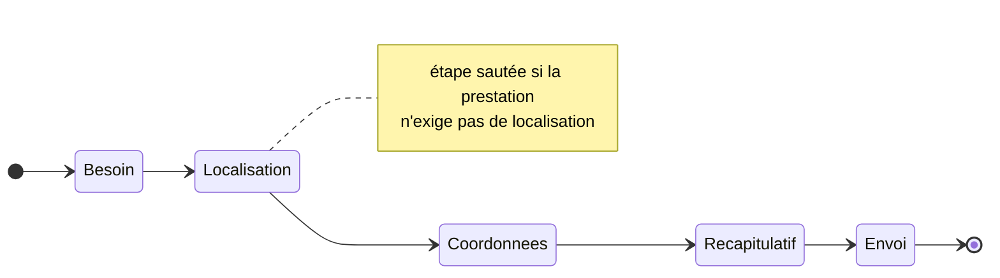
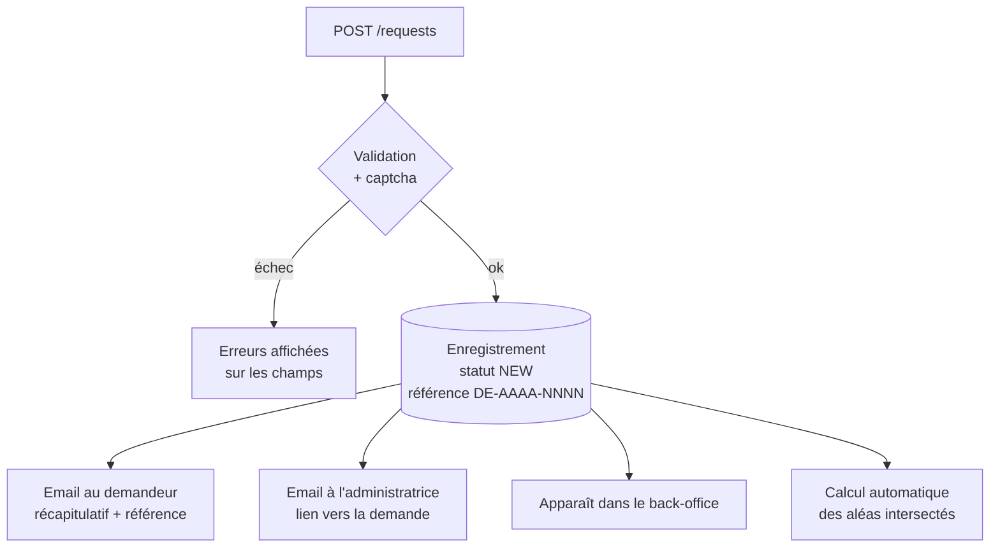

# Fiches prestations & « Demander une étude »

[← Sommaire](../README.md) · Lot 1 · Route `/$lang/demande-etude?prestation=…`

## Objectif

Un formulaire unique, utilisé par tous les volets, qui transforme une visite en demande exploitable : **qui**, **quoi**, **où**, **quels livrables**, **quand**.

## Points d'entrée



Les paramètres d'URL pré-remplissent le formulaire : `?prestation=<id>&lat=&lng=` ou `?zone=<geojson encodé>&deliverables=MAP,REPORT`.

## Formulaire en 4 étapes



| Étape | Champs | Obligatoire |
| --- | --- | --- |
| 1. Besoin | Volet et prestation (pré-remplis), livrables attendus (cases), description, délai souhaité, pièces jointes | Prestation, ≥ 1 livrable, description |
| 2. Localisation | Mini-carte (pointer ou dessiner), latitude/longitude, wilaya, commune | Si `requires_location` |
| 3. Coordonnées | Nom, organisme, type d'organisme, email, téléphone | Nom, email, téléphone |
| 4. Récapitulatif | Relecture, consentement, captcha invisible | Consentement |

### Composant LocationPicker

```
┌─────────────────────────────────────────────┐
│ [📍 Pointer] [⬠ Dessiner une zone] [✕ Effacer]│
│ ┌─────────────────────────────────────────┐ │
│ │        carte 2D satellite légère        │ │
│ │                ⬠ zone                   │ │
│ └─────────────────────────────────────────┘ │
│ Lat [36.75381]  Long [3.05882]  ou saisie   │
│ Wilaya [Alger ▾]  Commune [Bab Ezzouar ▾]   │
│ Surface : 12,4 ha                           │
└─────────────────────────────────────────────┘
```

Saisie manuelle des coordonnées possible (degrés décimaux ou DMS), synchronisée avec la carte. Wilaya et commune sont déduites des coordonnées (géocodage inverse) et restent modifiables.

### Pièces jointes

| Règle | Valeur |
| --- | --- |
| Types acceptés | PDF, JPG, PNG, DOCX, XLSX, CSV, KML, KMZ, GeoJSON, ZIP (shapefile) |
| Taille max | 25 Mo par fichier, 50 Mo pour les ZIP, 5 fichiers |
| Envoi | Direct vers Cloud Storage via URL signée |

## Après l'envoi



Le calcul des aléas intersectés (requête PostGIS sur les couches Tessera) donne à l'administratrice un premier diagnostic dès la réception.

## Brouillon local

Le formulaire est sauvegardé dans le navigateur à chaque étape (localStorage, sans pièces jointes) pour ne rien perdre en cas de fermeture accidentelle. Le brouillon est effacé après l'envoi.

## Critères d'acceptation

- [ ] Ouvert depuis une fiche, la prestation est pré-sélectionnée.
- [ ] Ouvert depuis la carte, la zone est reprise à l'identique.
- [ ] Les erreurs sont signalées champ par champ, en français.
- [ ] Deux emails partent dans la minute.
- [ ] La demande apparaît en back-office avec sa carte et ses fichiers.
