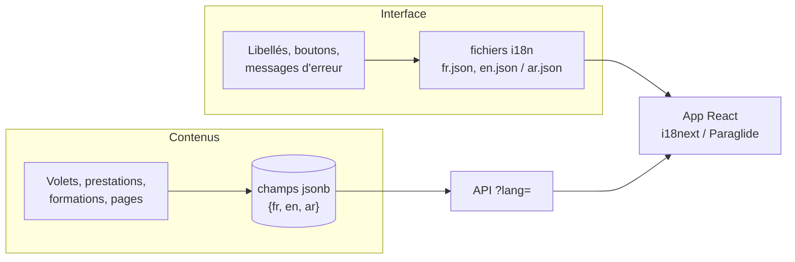

# Multilingue

[← Sommaire](../README.md) · Lot 3 (structure prête dès le lot 1)

## Principe

Français par défaut. Seconde langue à confirmer : **anglais** ou **arabe** ([point ouvert 2](../10-points-ouverts.md)). Contrairement à une traduction automatique par plugin, les textes sont traduits et relus, ce qui est meilleur pour la qualité et le référencement.

## Deux types de textes

## URL et SEO

- Préfixe de langue : `/fr/tessera`, `/en/tessera` (ou `/ar/tessera`).
- Balises `hreflang` sur chaque page, sitemap par langue.
- La langue choisie est mémorisée (cookie) ; première visite : langue du navigateur si disponible, sinon français.

## Si l'arabe est retenu

| Point | Traitement |
| --- | --- |
| Sens d'écriture | `dir="rtl"` sur `<html>`, propriétés CSS logiques (`margin-inline-start`…) dès le lot 1 |
| Police | IBM Plex Sans Arabic |
| Icônes directionnelles | Flèches inversées automatiquement |
| Carte | Libellés Google en arabe via le paramètre de langue |
| Chiffres | Chiffres occidentaux conservés pour les coordonnées et mesures |

## Back-office

Chaque champ traduisible affiche un onglet par langue ; un indicateur signale les traductions manquantes. Une traduction manquante retombe sur le français côté public.

## Critères d'acceptation

- [ ] Toutes les pages existent dans les deux langues.
- [ ] Le changement de langue garde la page courante.
- [ ] Aucun texte d'interface codé en dur.
