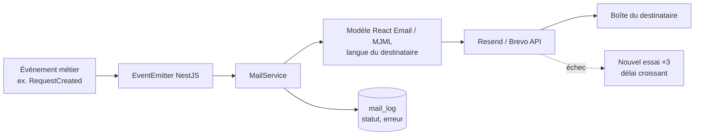

# Notifications email

[← Sommaire](../README.md) · Lot 1

## Catalogue des emails

| Événement | Destinataire | Contenu |
| --- | --- | --- |
| Demande d'étude reçue | Demandeur | Référence, récapitulatif, délai de réponse |
| Demande d'étude reçue | Administratrice | Résumé + lien back-office |
| Changement de statut (si coché) | Demandeur | Nouveau statut, message facultatif |
| Inscription formation | Demandeur | Confirmation, suite du processus |
| RDV réservé | Client | Date, modalité, lien Meet ou adresse, `.ics`, liens annuler/reporter |
| RDV réservé / annulé / reporté | Administratrice | Détail |
| Rappel RDV (J−1) | Client | Rappel + liens |
| Signalement reçu | Signaleur (si email) | Remerciement |
| Signalement reçu | Administratrice | Lien vers la file de modération |
| Message de contact | Visiteur / Administratrice | Accusé de réception / transfert avec Reply-To |
| Échéance abonnement (J−30, J−7) | Partenaire + Administratrice | Date d'échéance |
| Compte créé / mot de passe oublié | Utilisateur | Lien à usage unique |

## Chaîne d'envoi

## Règles

- Expéditeur sur le domaine de la cliente (`contact@…`) avec SPF, DKIM et DMARC configurés pour éviter les spams.
- Modèles bilingues, éditables dans le back-office (objet + corps, variables `{{reference}}`, `{{name}}`…).
- Aucune pièce jointe du demandeur n'est renvoyée par email : lien sécurisé vers le back-office uniquement.

## Critères d'acceptation

- [ ] Chaque événement du tableau déclenche son email.
- [ ] Les emails arrivent en boîte de réception (test Gmail et Outlook).
- [ ] Un échec d'envoi est journalisé et réessayé.
