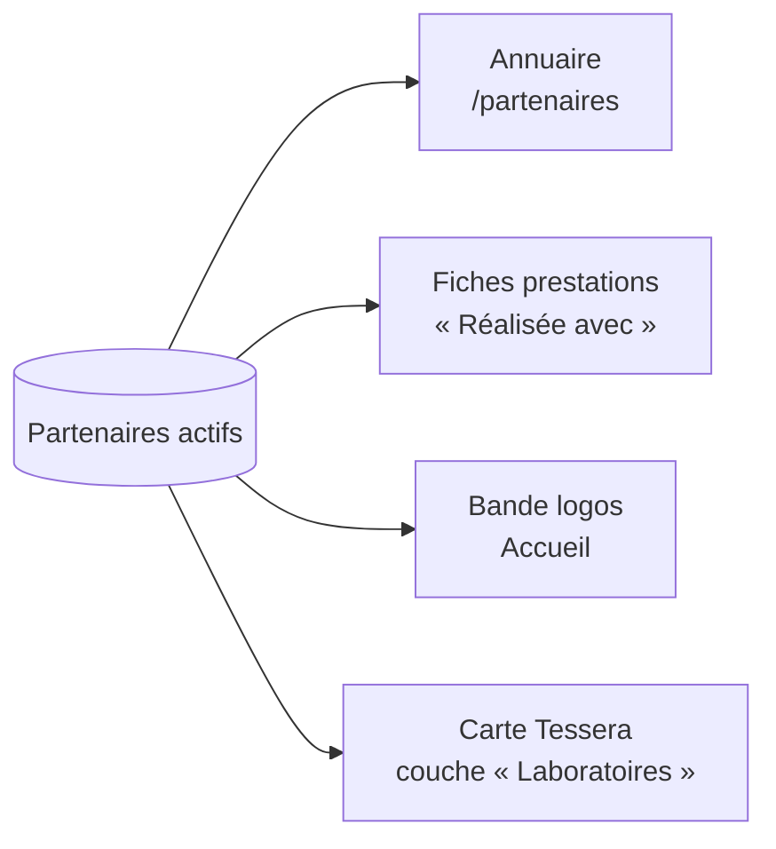
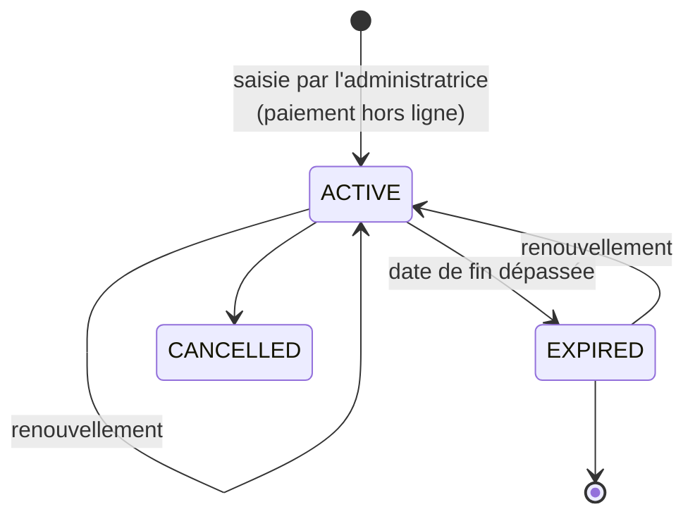

# Partenaires et abonnements

[← Sommaire](../README.md) · Lot 3

## Objectif

Les analyses qui demandent équipements, campagnes de terrain ou essais spécialisés sont proposées avec des laboratoires et organismes partenaires. Ces partenaires peuvent **payer un abonnement pour être affichés** (demande de la cliente).

## Où apparaissent les partenaires

## Formules (paliers à définir avec la cliente)

| Formule | Visibilité (proposition) |
| --- | --- |
| Essentiel | Fiche dans l'annuaire |
| Visibilité | + logo sur les fiches prestations de sa spécialité |
| Premium | + bande logos de l'accueil + mise en avant sur la carte |

## Cycle d'un abonnement

- Une tâche quotidienne (Cloud Scheduler) passe les abonnements échus en `EXPIRED` et retire l'affichage.
- Emails automatiques : rappel 30 jours et 7 jours avant l'échéance, au partenaire et à l'administratrice.
- Paiement en ligne : hors périmètre ; l'abonnement est saisi après paiement par virement ou CCP.

## Espace partenaire (phase 2)

Un compte `PARTNER` peut modifier sa fiche (logo, description, spécialités, contact) ; les modifications sont validées par l'administratrice avant publication.

## Critères d'acceptation

- [ ] Annuaire filtrable par spécialité.
- [ ] Le partenaire n'est plus affiché le lendemain de l'échéance.
- [ ] Rappels d'échéance envoyés.
