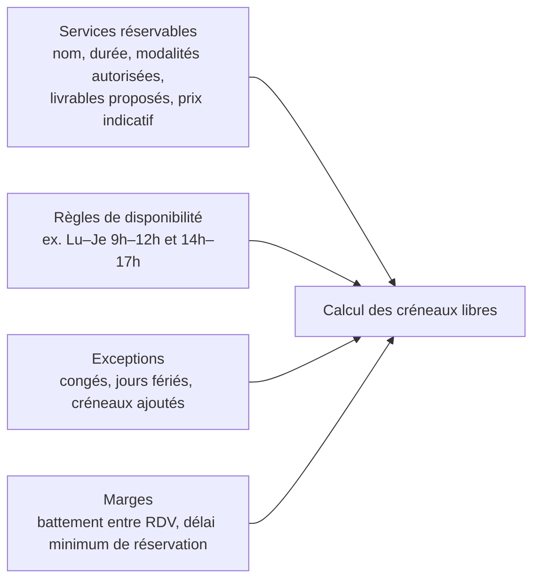
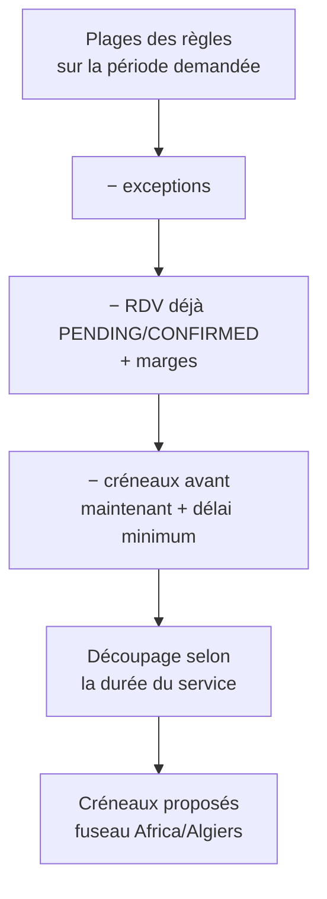
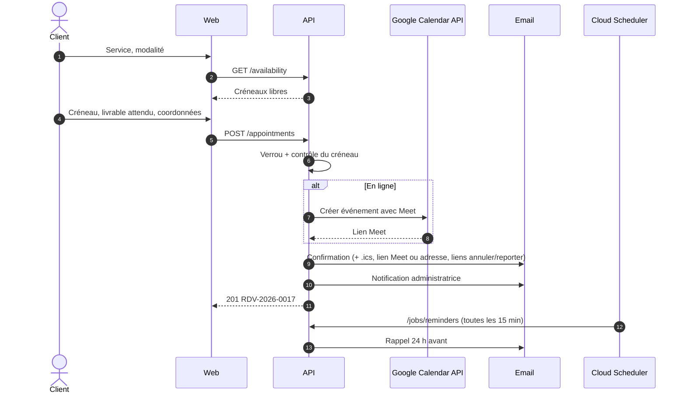

# Réservation de rendez-vous

[← Sommaire](../README.md) · Lot 2 · Route `/$lang/rendez-vous?service=…`

## Objectif

Permettre de réserver un créneau pour un service BatiVex, une séance de coaching IZIRA ou un échange formation, en présentiel ou en ligne.

## Paramétrage côté administratrice



## Calcul des créneaux



La contrainte d'unicité en base (`starts_at`, `service_offer_id`) empêche deux réservations simultanées sur le même créneau : la seconde reçoit `409 SLOT_TAKEN` et voit les créneaux rechargés.

## Parcours



## Annulation et report

- Chaque email contient deux liens signés (jeton unique) : **Annuler** et **Reporter**.
- Annulation possible jusqu'à 12 h avant (paramétrable) ; au-delà, le lien invite à contacter directement.
- Report : réouvre le sélecteur de créneaux, libère l'ancien créneau, envoie un nouvel email.

## Vue back-office

```
┌─────────────────────────────────────────────────────────────┐
│ Rendez-vous            [Semaine ▾]  ◀ 2–6 nov. 2026 ▶       │
├──────┬──────────┬──────────┬──────────┬──────────┬──────────┤
│      │ Lun 2    │ Mar 3    │ Mer 4    │ Jeu 5    │ Ven 6    │
│ 09:00│          │■ Coaching│          │■ BatiVex │          │
│      │          │ en ligne │          │présentiel│          │
│ 10:00│■ BatiVex │          │          │          │          │
│ 14:00│          │          │░ congé ░ │          │          │
├──────┴──────────┴──────────┴──────────┴──────────┴──────────┤
│ Clic → détail : client, livrable, description, lien Meet,   │
│ [Confirmer] [Reporter] [Annuler] [Marquer effectué/absent]  │
└─────────────────────────────────────────────────────────────┘
```

## Critères d'acceptation

- [ ] Aucun créneau hors disponibilités n'est proposé.
- [ ] Deux personnes ne peuvent pas réserver le même créneau.
- [ ] Le lien Meet est présent pour les RDV en ligne.
- [ ] Le rappel part 24 h avant ; annulation et report fonctionnent depuis l'email.
