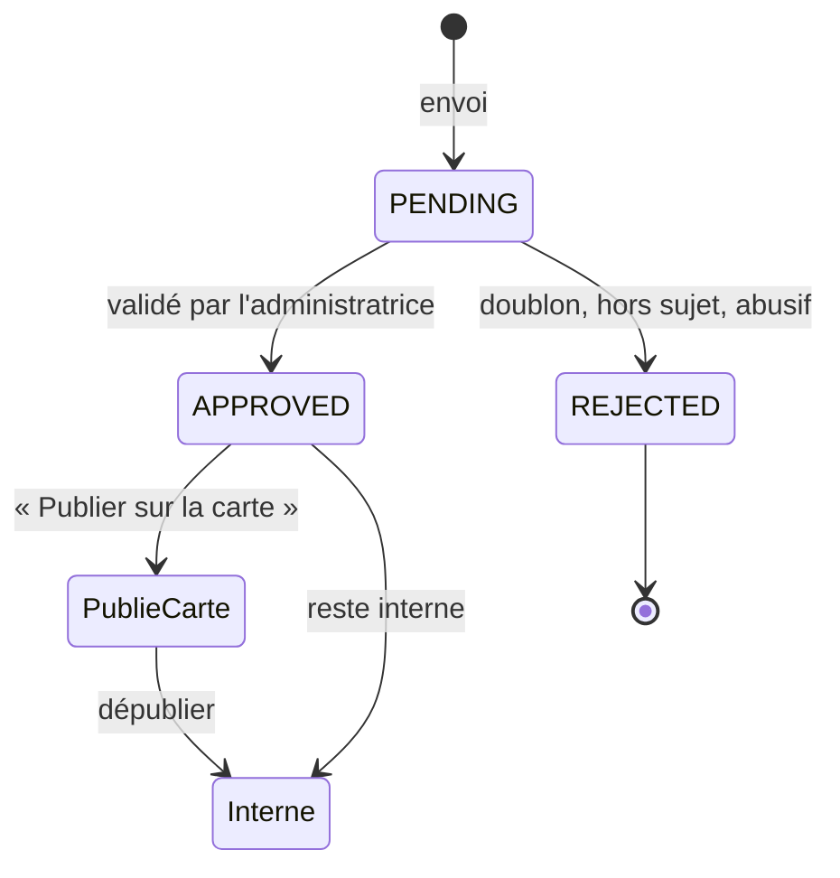
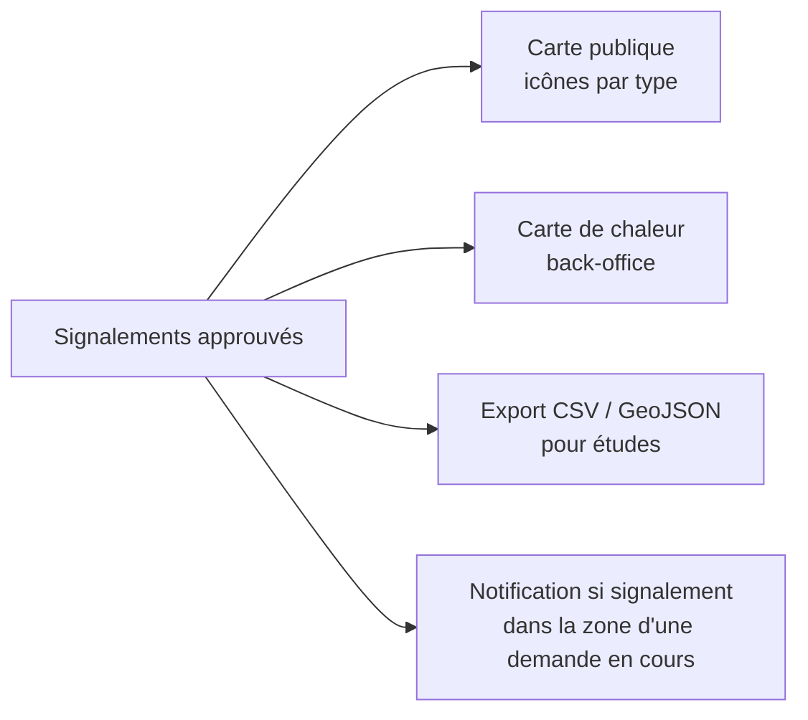

# Signalement d'un risque

[← Sommaire](../README.md) · Lot 2 · Route `/$lang/tessera/signaler`

## Objectif

Permettre à tout visiteur de signaler un aléa observé (glissement, fissure, inondation…). Fonction existante à **conserver et corriger** ; liste d'aléas étendue.

## Formulaire

| Champ | Type | Obligatoire |
| --- | --- | --- |
| Type de risque | Liste (15 aléas Tessera) avec icônes | Oui |
| Localisation | Point ou zone sur la carte, ou « Ma position » (géolocalisation du navigateur) | Oui |
| Date d'observation | Date (par défaut aujourd'hui) | Oui |
| Gravité perçue | Faible / Moyenne / Forte | Non |
| Description | Texte (≥ 20 caractères) | Oui |
| Photos | Jusqu'à 5 images, 10 Mo chacune, compressées côté navigateur | Non |
| Anonyme | Case | — |
| Nom, email, téléphone | Si non anonyme | Email si non anonyme |
| Consentement | Case | Oui |

```
┌─────────────────────────────────────────────┐
│ Signaler un risque                          │
├─────────────────────────────────────────────┤
│ Type  [🟤 Glissement de terrain        ▾]   │
│ Où ?  [📍 Ma position] ou carte ↓           │
│ ┌─────────────────────────────────────────┐ │
│ │               carte 2D                  │ │
│ └─────────────────────────────────────────┘ │
│ Observé le [22/10/2026]  Gravité ○ ● ○      │
│ Description [__________________________]    │
│ Photos [＋][img][img]                       │
│ ☐ Rester anonyme                            │
│ Email [__________]  ☐ J'accepte… *          │
│                              [Envoyer]      │
└─────────────────────────────────────────────┘
```

## Modération



- Aucun signalement n'apparaît sur la carte sans validation.
- Sur la carte publique : type, date, description et photos validées. **Jamais** le nom, l'email ou le téléphone.
- Les photos sont débarrassées de leurs métadonnées EXIF (position, appareil) avant publication.

## Exploitation



## Critères d'acceptation

- [ ] Les 15 types d'aléas sont proposés.
- [ ] Signalement anonyme possible.
- [ ] File de modération dans le back-office, avec carte et photos.
- [ ] Données personnelles jamais visibles publiquement ; EXIF supprimés.
